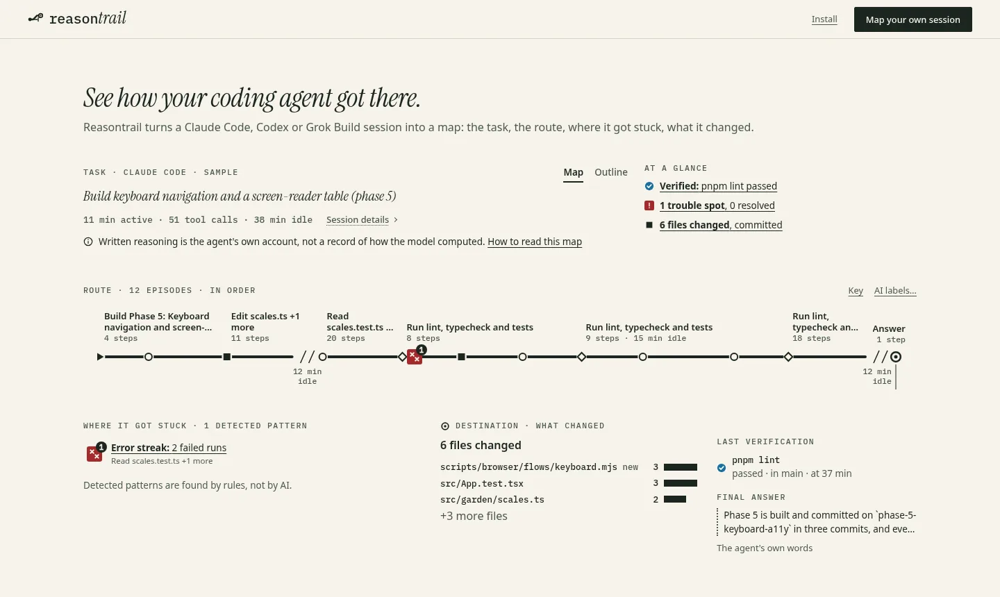

<h1 align="center">
  <picture>
    <source media="(prefers-color-scheme: dark)" srcset="docs/brand/wordmark-dark.png">
    
  </picture>
</h1>

<p align="center"><strong>See how your coding agent got there: one command turns a Claude Code, Codex or Grok Build session into a map you can read at a glance. Local, no API key, nothing uploaded.</strong></p>

<p align="center">
  <a href="https://reasontrail.geekplux.com">Live demo</a>&emsp;
  <a href="#quick-start">Quick start</a>&emsp;
  <a href="#how-it-works">How it works</a>&emsp;
  <a href="docs/EXTENDING.md">Extend it</a>
</p>

<p align="center">
  
</p>

## Quick start

```sh
npx reasontrail install-skill   # once: adds the skill to your agents
npx reasontrail                 # or map this folder's newest session
```

Then ask your agent to "map this session" (`/reasontrail`, or `$reasontrail` in Codex). It opens the map in your browser and replies with the file path.

### From a clone

To work on Reasontrail itself, run the same commands from a clone, with `node cli/dist/cli.mjs` in place of `npx reasontrail` (Node 22+ and pnpm 9):

```sh
git clone https://github.com/geekplux/reasontrail && cd reasontrail
pnpm install && pnpm build:cli && node cli/dist/cli.mjs install-skill
```

More commands:

```sh
npx reasontrail --list                  # the 10 most recent sessions for this folder, from all three agents
npx reasontrail path/to/session.jsonl   # any session file or session id
npx reasontrail --share                 # a redacted copy in the current folder; read it before you send it
```

## What you see

One page, read top to bottom:

- **The tree.** The session grows left to right in the order it happened. The main agent is the trunk, each subagent a limb that leaves it where it was spawned, each episode a branch (▶ task, ○ explore, ■ change, ◇ verify, ◉ answer) and each tool call a twig: a leaf when it worked, an orange twig with ✕ when it failed. A part's width follows the tool calls still ahead of it, so the busy stretches stand out. Each limb ends in its verdict: failed, committed, passed.
- **The list.** Under the tree, the same session as a git-style list: the main agent's rail, a fork for each subagent with its episodes and a merge after its verdict. Open an episode to see its tool calls and thinking; hover or focus a row and the tree shows its path.
- **The outcome.** The last check and whether it passed, the trouble found (failed reviews, error streaks, retries, reverts), the files that changed, and the agent's final answer.

Click a twig, or press Enter on a step in the list (the [examples](examples/README.md) link straight to a few worth reading): its path from the root turns blue and the step's panel opens with the command, its output, the next step, and the file and line it came from, with the raw record one click away.

## How it works

```text
session files              step graph (rules, no AI)        map (one HTML file)
Claude Code  ─┐            steps, lanes, edges              tree: trunk, limbs, branches, twigs
Codex        ─┼─ adapter ─▶ episodes, trouble, outcome ─────▶ git-style list
Grok Build   ─┘            provenance for every step        outcome box and step panel
```

1. **Adapters** read each agent's transcript files where the agent keeps them (`~/.claude/projects`, `~/.codex/sessions`, `~/.grok/sessions`) and turn them into one neutral format.
2. **The step graph** is built by deterministic rules: the same session always gives the same map, and every step links back to the file and line it came from.
3. **The map** is a single self-contained HTML file. It opens from `file://`, works offline and makes no requests.
4. **Optional AI titles.** With `--ai` (or "AI titles" on the website) a model tags each episode with a short title from a fixed set (sub-question, hypothesis, evidence, dead end, decision, answer), shown beside the list's rows and as a ring on the tree. It shows what would be sent and asks first, sends only redacted one-line step summaries, and names the model that suggested the titles. Until the hosted Worker is live, point it at your own with `--api <url>` (see docs/EXTENDING.md). Switch them off and the map is exactly as before.
5. **The zoom-in lens.** The next-token garden shows an open model's next-token choices for a sentence as a garden of branches, where thickness is probability. Recorded sentences work offline; others grow live through a Worker (yours, until the hosted one is live), only when you ask.

## Privacy and honesty

- Everything runs on your machine. The CLI reads only the session's files and writes one HTML file; it makes no network request unless you pass `--ai`. The website parses dropped files in your browser and uploads nothing. It counts page views with Google Analytics: one per visit, with the page's path and nothing else, never a file, a map or anything in them (no events, no Google signals, no ad personalisation; Google Analytics sets its own `_ga` cookies; [src/analytics.ts](src/analytics.ts)). The CLI's maps load no analytics.
- The default map is private and unredacted. `--share` (or "Share" on a map) replaces secrets, tokens, emails and home paths with typed placeholders and tells you how many it replaced.
- Written reasoning is the model's own account, not a record of how it computed; a thinking step's panel says so. Thinking whose text was not stored is shown as such; nothing is invented for it. Trouble (error streaks, retries, reverts, failed reviews) is found by fixed rules, not by a model.
- Codex support is built from the public session format and has not yet been checked against a real Codex session.

## Accessibility

The list is the keyboard path to everything: one Tab stop, a WAI-ARIA tree with arrow keys, Home/End, → to open an episode, Enter for a step's panel and Esc to close it, and focus in the list lights the same path in the tree. The tree itself is a picture with a one-sentence text summary. Every mark has a shape as well as a colour (✕ and ⚠ for failures, ✓ for passes), the blue and orange pair passes protanopia, deuteranopia and tritanopia checks in light and dark, and only colour and opacity ever move, not at all under reduced motion. The lens has a Table view as its text alternative.

## Extend it

- **A new agent:** write an adapter (text in, `NormalizedSession` out) and prove it with the shared contract suite.
- **The Worker:** a Cloudflare Worker serves the optional AI titles (`/api/structure`) and the lens (`/api/next-tokens`) from Workers AI with no key, or from any OpenAI-compatible server, with caching, rate limits and a daily budget.
- **Samples, gardens and themes:** record your own.

[`docs/EXTENDING.md`](docs/EXTENDING.md) has the files to touch and the check that proves each one works.

## Roadmap

- [ ] Check the Codex adapter against real sessions.
- [ ] Follow a running session live (`--watch`).
- [ ] More agents: Cursor, Aider.
- [ ] Show which steps support the final answer (the CLI already computes these links with `--ai`).
- [ ] Export a session's list as Markdown for pull request descriptions.

Ideas that are ready to pick up are in [`docs/GOOD-FIRST-ISSUES.md`](docs/GOOD-FIRST-ISSUES.md).

## Contributing

Contributions are welcome: read [`CONTRIBUTING.md`](CONTRIBUTING.md) for setup and checks, [`docs/ARCHITECTURE.md`](docs/ARCHITECTURE.md) for how the code fits together, and the [Code of Conduct](CODE_OF_CONDUCT.md). Report security issues privately as described in [`SECURITY.md`](SECURITY.md). Changes are listed in [`CHANGELOG.md`](CHANGELOG.md).

This project is built by a team of AI agents; see the PR history. The sample maps on the website are their own sessions.

## License

[MIT](LICENSE)
