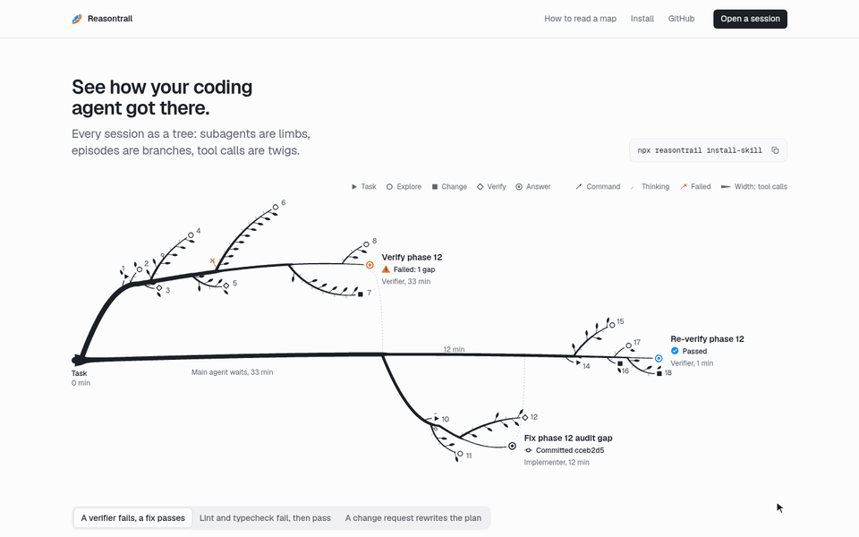

<h1 align="center">
  <picture>
    <source media="(prefers-color-scheme: dark)" srcset="docs/brand/wordmark-dark.png">
    
  </picture>
</h1>

<p align="center"><strong>See how your coding agent got there: one command turns a Claude Code, Codex or Grok Build session into a map you can read at a glance. Local, no API key, nothing uploaded.</strong></p>

<p align="center">
  <a href="https://reasontrail.geekplux.com">Live demo</a> ·
  <a href="#quick-start">Quick start</a> ·
  <a href="#how-it-works">How it works</a> ·
  <a href="docs/EXTENDING.md">Extend it</a>
</p>

<p align="center">
  <picture>
    <source media="(prefers-reduced-motion: reduce)" srcset="docs/brand/hero.webp">
    
  </picture>
  <br><sub><a href="docs/brand/hero.webp">Still image</a> · <a href="examples/README.md">Three example maps</a></sub>
</p>

## Quick start

**Not on npm yet.** These commands work once it is published; until then use [From a clone](#from-a-clone).

```sh
npx reasontrail install-skill   # once: adds the skill to your agents
npx reasontrail                 # or map this folder's newest session
```

Then ask your agent to "map this session" (`/reasontrail`, or `$reasontrail` in Codex). It opens the map in your browser and replies with the file path.

### From a clone

Until the package is published, run the same commands from a clone, with `node cli/dist/cli.mjs` in place of `npx reasontrail` (Node 20.19+ and pnpm 9):

```sh
git clone https://github.com/geekplux/reasontrail && cd reasontrail
pnpm install && pnpm build:cli && node cli/dist/cli.mjs install-skill
```

More commands:

```sh
npx reasontrail --list                  # the 10 most recent sessions for this folder, from all three agents
npx reasontrail path/to/session.jsonl   # any session file or session id
npx reasontrail --share                 # a redacted copy in the current folder; read it before you send it
```

## What you see

One page answers four questions, in this order:

- **Task:** what you asked, with the agent, model, time and counts.
- **Route:** the session cut into up to 12 named episodes (▶ request, ○ exploring, ■ changing files, ◇ verifying, ● delegating, ◉ answer). Subagents are side trails under the episode that started them.
- **Where it got stuck:** numbered markers for error streaks, retries, reverts, rewinds, interruptions and churn, each with its evidence.
- **Destination:** the files that changed, the last test, build, lint or typecheck run, and the agent's final words.

Press Enter on any episode or marker for its steps (the [examples](examples/README.md) link straight to a few worth reading): the command and its output, an edit as a diff, a file read, a subagent's own trail, and the raw record behind it. The Outline view shows the same thing as plain text.

## How it works

```text
session files              step graph (rules, no AI)        map (one HTML file)
Claude Code  ─┐            steps, lanes, edges              task card
Codex        ─┼─ adapter ─▶ episodes, trouble, outcome ─────▶ route and side trails
Grok Build   ─┘            provenance for every step        trouble markers, destination
```

1. **Adapters** read each agent's transcript files where the agent keeps them (`~/.claude/projects`, `~/.codex/sessions`, `~/.grok/sessions`) and turn them into one neutral format.
2. **The step graph** is built by deterministic rules: the same session always gives the same map, and every step links back to the file and line it came from.
3. **The map** is a single self-contained HTML file. It opens from `file://`, works offline and makes no requests.
4. **Optional AI labels.** With `--ai` (or "AI labels…" on the website) a model suggests labels such as hypothesis, evidence or dead end, and links the final claim to the steps that support it. It shows what would be sent and asks first, sends only redacted one-line step summaries, and every label says which model suggested it. Until the hosted Worker is live, point it at your own with `--api <url>` (see docs/EXTENDING.md). Switch the overlay off and the map is exactly as before.
5. **The zoom-in lens.** Pick a sentence the agent wrote and see an open model's next-token choices as a garden of branches, where thickness is probability. Recorded sentences work offline; others grow live through a Worker (yours, until the hosted one is live), only when you ask.

## Privacy and honesty

- Everything runs on your machine. The CLI reads only the session's files and writes one HTML file; it makes no network request unless you pass `--ai`. The website parses dropped files in your browser and uploads nothing.
- The default map is private and unredacted. `--share` (or "Save shareable copy…") replaces secrets, tokens, emails and home paths with typed placeholders and tells you how many it replaced.
- Written reasoning is the agent's own account, not a record of how the model computed. Thinking whose text was not stored is shown as such; nothing is invented for it. Trouble markers are patterns found by fixed rules, and the page says so.
- Codex support is built from the public session format and has not yet been checked against a real Codex session.

## Accessibility

The map is one Tab stop with arrow keys, Home/End and `[` `]` to step through the trouble markers. Every glyph has a shape and a text label, so colour is never the only signal, and the palettes pass protanopia, deuteranopia and tritanopia checks in light and dark themes. Motion follows your reduced-motion setting, and the Outline and the lens's Table view are full text alternatives.

## Extend it

- **A new agent:** write an adapter (text in, `NormalizedSession` out) and prove it with the shared contract suite.
- **The Worker:** a Cloudflare Worker serves the optional AI labels (`/api/structure`) and the lens (`/api/next-tokens`) from Workers AI with no key, or from any OpenAI-compatible server, with caching, rate limits and a daily budget.
- **Samples, gardens and themes:** record your own.

[`docs/EXTENDING.md`](docs/EXTENDING.md) has the files to touch and the check that proves each one works.

## Roadmap

- [ ] Publish `npx reasontrail` to npm and deploy the showcase site (waiting for review).
- [ ] Check the Codex adapter against real sessions.
- [ ] Follow a running session live (`--watch`).
- [ ] More agents: Cursor, Aider.
- [ ] Export the outline as Markdown for pull request descriptions.

Ideas that are ready to pick up are in [`docs/GOOD-FIRST-ISSUES.md`](docs/GOOD-FIRST-ISSUES.md).

## Contributing

Contributions are welcome: read [`CONTRIBUTING.md`](CONTRIBUTING.md) for setup and checks, and the [Code of Conduct](CODE_OF_CONDUCT.md). Report security issues privately as described in [`SECURITY.md`](SECURITY.md). Changes are listed in [`CHANGELOG.md`](CHANGELOG.md).

This project is built by a team of AI agents; see the PR history. The sample maps on the website are their own sessions, and [`docs/PLAN.md`](docs/PLAN.md) is the plan they work from.

## License

[MIT](LICENSE)
