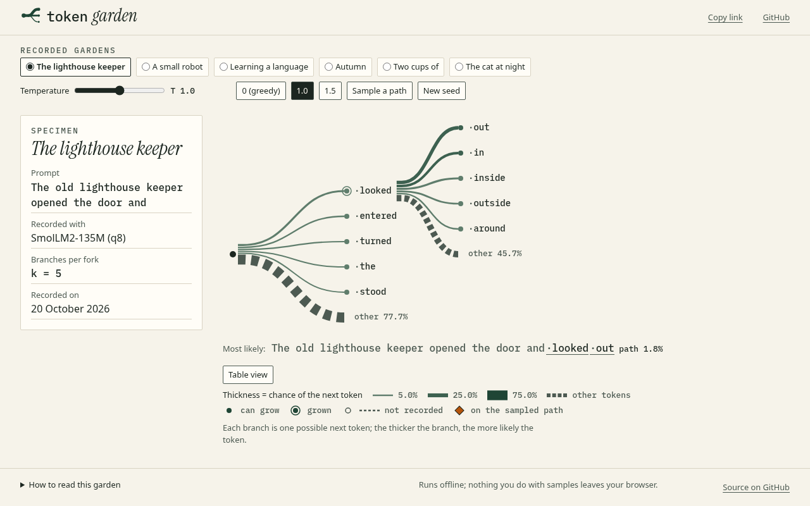
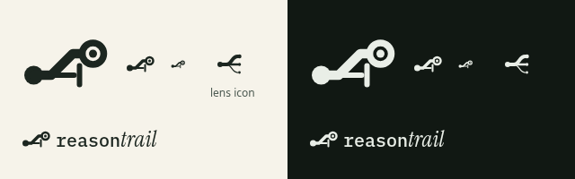
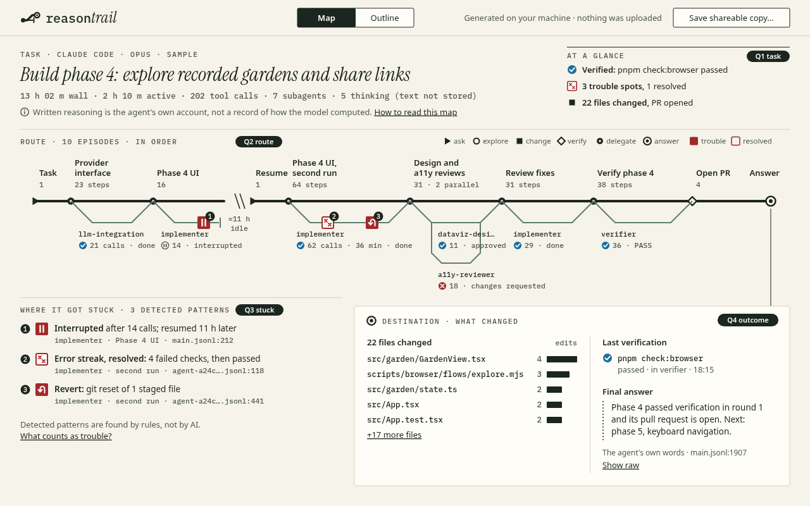
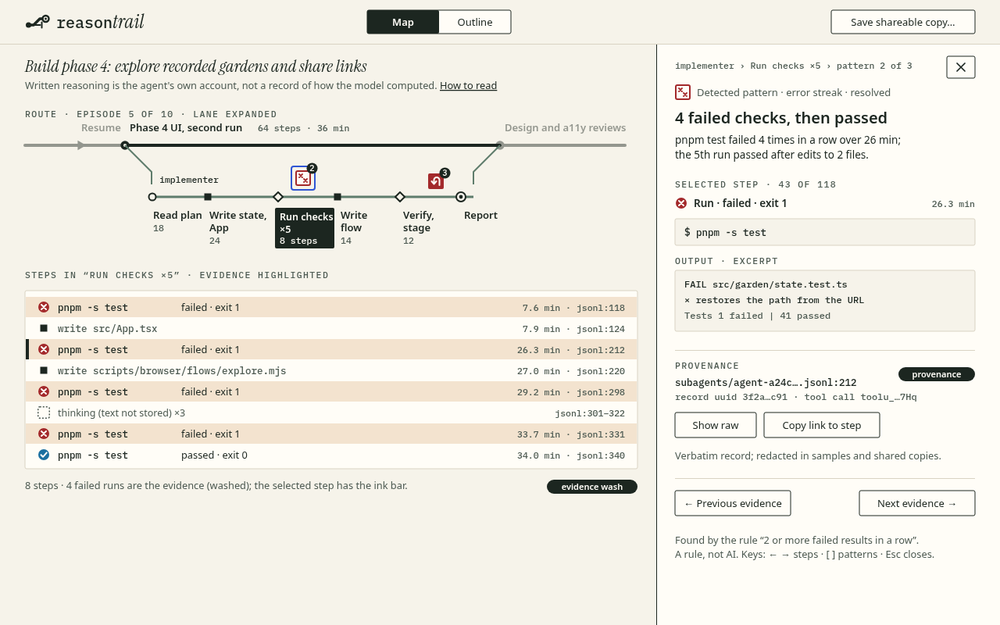

# Reasontrail: design

Owner: `lead-designer`. Written in phase 10 (2026-10-20). This file supersedes PLAN.md §3 for the reasoning map and for identity. PLAN §3 and `docs/viz/garden.md` stay the spec for the garden, which is now the zoom-in lens.

Every buildable item has a phase tag, so later phases know what is theirs:

| Tag | Phase |
|---|---|
| **[13]** | CLI, local viewer (outline view) and rename |
| **[14]** | skill |
| **[15]** | samples |
| **[16]** | map glance view |
| **[17]** | detail panel and provenance |
| **[18]** | Codex and Grok Build |
| **[19]** | website showcase and drop zone |
| **[21]** | AI labels overlay |
| **[22]** | zoom-in lens |
| **[23]** | chat import |
| **[24]** | share cards |

Contents:

1. Concept
2. References (principles only)
3. Audit of the current UI
4. Name, wordmark and mark
5. Type
6. Colour
7. Spacing, grid and breakpoints
8. The map's visual grammar
9. Glance layouts
10. Detail panel, outline view, keyboard and screen readers
11. Motion
12. States
13. Chrome and surfaces (viewer, website, drop zone, lens, AI overlay, chat, sources, share)
14. Build notes (tokens, test hooks)
15. Design acceptance criteria DM1–DM38
16. The 5-second review protocol
17. Sign-off procedure
18. Calm layout (CL1–CL14, binding from phase 18)

---

## 1. Concept

**Reasontrail draws an AI session as a trail map.**

- The **trailhead** is the task.
- One inked **route** of named episodes shows how the agent went about it.
- **Side trails** are subagents.
- **Blazes** mark where it got stuck or turned back.
- The **destination** card shows what it changed and answered.

Every mark is a recorded step, and its raw line is one click away.

The identity is a field notebook. Phases 2–9 used it for a botanical specimen plate; here it becomes a surveyor's trail map: warm paper, ink, IBM Plex Mono for machine facts, and Instrument Serif Italic for names. The garden lives on inside this as the lens. You zoom from a trail into one sentence and see the branching possibilities under it.

### 1.1 The glance brief (the four questions)

The top-level view must answer these within 5 seconds, with no interaction:

| # | Question | Answered by | Region (`data-region`) |
|---|---|---|---|
| Q1 | What was the task? | Trailhead card: the serif title and the meta row | `task` |
| Q2 | What was the main route? | The route: ≤ 12 named episodes in order, with side trails | `route` |
| Q3 | Where did it get stuck or backtrack? | Numbered blazes on the route, plus the "Where it got stuck" list | `trouble` |
| Q4 | What did it finally change or answer? | The destination card, plus the "At a glance" rows | `outcome` |

The "At a glance" rows (§8.9) answer Q1, Q3 and Q4 in three short lines. They are the fallback when the route is long, and they are what mobile shows above the fold.

### 1.2 Principles

1. **Order, not clock time.** The real session behind the wireframes has an 11-hour idle gap inside 2 h 10 m of work. A linear time axis would spend 85 % of the width on nothing. Position therefore encodes sequence, length encodes effort (steps), and idle gaps are drawn as breaks with their duration written out.
2. **Colour means something, or it is not there.** Two hues carry meaning: lake blue for verified/ok and blaze red for trouble/error. Everything else is ink, paper and moss. Every hue is paired with a shape and a word.
3. **Line style says who is speaking.** Solid means a recorded fact (tool calls, results, files). Dotted means the agent's own words (assistant text, thinking). Dashed means a model's suggestion (AI labels). "Detected pattern" marks rules.
4. **Provenance everywhere.** Every element can name its `file:line`.
5. **Details on demand.** The glance never needs a click. Everything else is one click or one key away.

---

## 2. References (principles taken, nothing copied)

| Reference | Principle used here |
|---|---|
| Beck's Underground diagram, Vignelli's 1972 subway map | Topology over geography: 45° geometry and stations in order. This is our ordinal route with octilinear side trails |
| Swiss topographic hiking maps | A restrained base with very few semantic colours, and hazards marked by a standard glyph. This gives the two-hue palette and the blazes |
| NYT and Reuters annotated graphics | Numbered callouts on the chart, keyed to a short text list. This gives the numbered blazes and the "Where it got stuck" list |
| Sankey and flow maps | Width or length encodes volume. Here episode length is proportional to √steps |
| `git log --graph`, GitHub's network graph | Lanes for parallel lines of work. Our subagent side trails use the same idea but stay straight and labelled, never spaghetti |
| Flame charts in browser devtools | Lanes in time. Rejected as the primary form because idle gaps dominate (§1.2), but kept for the detail step strip |
| Observable, Bret Victor's explorables | Every number links to its source, and the reader can drill in without losing context |
| The Pudding | A plain-language summary above the chart. This gives the "At a glance" rows |
| Linear, Vercel, Stripe docs | Keyboard first, hairlines instead of shadows, dense but calm type, and code beside explanation (the detail panel) |
| Figma, Arc | Spatial continuity: zooming keeps the reader oriented. This drives the lens transition (§13.5) |

Explicitly not used: decorative 3D, gradients, glassmorphism, card grids, illustration, and Sean's study sites.

---

## 3. Audit of the current UI (phases 1–9, garden as first view)

Screenshots: `docs/screenshots/phase-10/audit-garden-desktop.png` (1280×800, light), `audit-garden-mobile.png` (390×844) and `audit-garden-dark.png` (1280×800, dark, hover on "·around").



### 3.1 Keep (and where it goes)

| What works | Evidence | Carried into |
|---|---|---|
| Paper, ink and moss palette with a calm dark "night" theme | All three screenshots | Base tokens, unchanged [13] |
| Plex Mono for machine text and Instrument Serif Italic for names | Specimen title, tokens | §5, with the same roles [13] |
| The specimen card: small-caps label, serif name, labelled fields | "SPECIMEN / The lighthouse keeper / Recorded with …" | The trailhead card copies this pattern: "TASK · …", a serif title, a meta row [13] |
| Probability is carried twice, by thickness and a number | Branch widths with "other 77.7 %"; dark hover "4.9 % · path 0.4 %" | The lens, unchanged. The hover label pattern is reused for map tooltips [16] |
| A legend made from the real marks, not abstract swatches | The row under the garden | The route legend is drawn with the same glyphs [16] |
| Provenance is stated ("Recorded with SmolLM2-135M (q8)") | Specimen card | Becomes a principle (§1.2.4) |
| A calm footer statement of privacy | "Runs offline; nothing you do with samples leaves your browser." | The viewer's "Generated on your machine · nothing was uploaded" [13] |
| Focus rings, reduced motion, table view | Phases 3–5 | The keyboard model (§10) and the outline view as the text alternative [13] |

### 3.2 Change

| # | Problem (where) | Why it matters | Change | Phase |
|---|---|---|---|---|
| A1 | The "other" remainder is the **heaviest mark** in the garden: thick dashes at 77.7 % and 45.7 % (desktop, dark) | The least informative element grabs the eye first | Lens: cap the remainder stroke at the width of the thickest real branch and render it as a light hatched band with the label | 22 |
| A2 | The garden uses about 45 % of the width; the right third is empty at 1280 (desktop) | Wasted canvas, and the composition looks unfinished | The map uses the full 12-column width (§9.1). The lens centres the garden and scales its node spacing to the width | 16, 22 |
| A3 | On mobile the **root is scrolled off-screen**; the first view starts mid-tree with "← Scroll sideways →" (mobile) | The first view hides the start of the story | The map turns vertical on mobile (§9.2) with no horizontal scroll. The lens opens scrolled to the root | 16, 22 |
| A4 | Six sample chips wrap to three rows and push the content down (mobile) | The chrome costs 300 px before any content | The website uses a single sample `<select>` below 768 px, and the viewer has no sample chrome | 19 |
| A5 | The control row is misaligned: the temperature presets start at x≈373 and are not on the slider's grid; button heights differ (desktop) | It reads as unfinished | All controls are 32 px high (44 px on mobile) and snap to the grid in §7 | 16, 22 |
| A6 | The legend sits below the readout, far from the marks, and below the fold on mobile | The encoding has to be learned before it is visible | The map legend sits inline in the route header (§9.1). The lens legend sits next to the specimen card | 16, 22 |
| A7 | "Copy link" and "GitHub" crowd the wordmark at 390 px (mobile) | The header looks cramped | Mobile header: mark, view toggle and a `⋯` menu (§9.2) | 16 |
| A8 | The wordmark says "token garden" | Rename | Reasontrail wordmark (§4) | 13 |
| A9 | The footer note is centred in a three-column footer and floats (desktop) | Weak alignment | Viewer: the note goes in the header. Website: a left-aligned footer | 13, 19 |
| A10 | The selected temperature chip "1.0" uses a filled pill that reads like a primary button (dark) | Mixed control semantics | Selected segment = ink fill and paper text inside a bordered group (the same as the Map/Outline toggle) | 22 |

---

## 4. Name, wordmark and mark [13]

**Decision: the mark changes; the type pairing stays.**

The seed-and-fork mark says "branching possibilities". That is exactly the lens, not the session map. A product called Reasontrail needs a mark that tells the map's story. The new mark keeps the old one's DNA: a filled start dot, stroked paths, round caps, `currentColor`, no text and a 32×32 box. The identity therefore evolves rather than breaks, and the old mark lives on as the **lens icon** (§13.5). The decision is recorded in DECISIONS.md by the main agent.



### 4.1 The mark: a trail with a dead end (`docs/design/mark.svg`)

It draws the four questions as one glyph:

- a trailhead dot (the task);
- a route that turns 45° (the route);
- a thinner straight spur that ends in a bar (a dead end: where it got stuck);
- a destination ring with a centre dot (the outcome).

```svg
<svg viewBox="0 0 32 32" fill="none" stroke="currentColor" stroke-linecap="round">
  <circle cx="4.5" cy="20" r="3.5" fill="currentColor" stroke="none"/>
  <path d="M4.5 20 H11 L19 12 H22" stroke-width="3.5" stroke-linejoin="round"/>
  <path d="M11 20 H19.5" stroke-width="2"/><path d="M21.5 16.5 V23.5" stroke-width="2"/>
  <circle cx="26.5" cy="12" r="4" stroke-width="2.5"/><circle cx="26.5" cy="12" r="1.5" fill="currentColor" stroke="none"/>
</svg>
```

- **Small sizes (≤ 20 px, favicon).** Drop the bar, keep the spur, and set the spur stroke to 2.5. At 16 px the bar merges into the ring.
- **Colour.**
  - Light theme: ink `#1c2620`.
  - Dark theme: `#e9eee7`.
  - The favicon keeps its embedded `prefers-color-scheme` style. The old favicon used `#1f4535` / `#d4ebdc`; the new one uses ink for maximum contrast at 16 px.
- **Files to update:** `public/favicon.svg`, `public/logo.svg` and `src/brand/LogoMark.tsx`. The component exports `TRAIL_MARK` paths in place of `MARK_BRANCHES`. `MARK_BRANCHES` moves to `src/lens/LensIcon.tsx` in phase 22. Phase 13 may keep a re-export until then.

### 4.2 Wordmark

- The mark, then "reason" in IBM Plex Mono 500, then "trail" in Instrument Serif Italic. The serif is set at 1.25× the mono size, both share a baseline, and there is **no space**: the change of typeface is the join.
- It is set lowercase, like the old wordmark. In running text the name is always "Reasontrail".
- Accessibility: `role="img" aria-label="Reasontrail"`. No hidden hyphen is needed.
- Sizes:
  - header: mono 20 px / serif 25 px;
  - mobile header: 16 / 20;
  - README, social: 40 / 50.
- The mark-to-text gap is 0.4em, and the mark height is 1.6× the mono cap height.
- The concept is the same as before: a machine word and a human word.

---

## 5. Type [13]

The faces and budget are unchanged from PLAN §3.1: ≤ 45 KB, two woff2 files, inlined in the viewer (D32).

| Role | Face | Size / weight | Where |
|---|---|---|---|
| Task title | Instrument Serif Italic | 31 px desktop, 25 px at < 768, 22 px compact in detail mode; line-height 1.15; ≤ 2 lines, then "more" | Trailhead card |
| Section labels | Plex Mono 500, uppercase, letter-spacing 0.12em | 11.5 px, `--tg-ink-muted` | "TASK ·", "ROUTE ·", "WHERE IT GOT STUCK ·", "DESTINATION ·" |
| Episode titles | System UI 600 | 13 px desktop, 14 px mobile; ≤ 2 lines | Above the route |
| Counts, durations, provenance, commands, file paths, lane names | Plex Mono 500, `tabular-nums` | 11.5–12.8 px (never under 11.5; 12 on mobile) | Everywhere data is shown |
| Body, summaries, buttons | System UI 400 / 600 | 13–13.5 px; panel title 20 px / 600 | Panels and cards |
| AI label tags [21] | Instrument Serif Italic | 12.8 px | Overlay only, so suggestions read as annotations and not as data |

Rules:

- Text never takes a series colour. Status words are ink; the glyph next to them carries the hue.
- Layout never measures text. Mono width is 0.6em per character. UI text is estimated at 0.55em per character, plus a 12 px safety margin.

---

## 6. Colour [13 tokens for the outline; 16 for the map]

### 6.1 Jobs

| Job | Token(s) | Paired non-colour cue |
|---|---|---|
| Main route and all text | `--tg-ink`, `--tg-ink-muted` (existing) | 4 px width; the position (top) |
| Side trails (subagents) | `--tg-lane` (strokes only, never text) | 2 px width, below the route, 45° joins, a mono agent name in ink |
| Verified / ok | `--tg-ok` (lake) | ✓ inside a circle + the word ("passed", "done", "approved") |
| Trouble and error | `--tg-trouble` (blaze); `--tg-error` stays the **text** colour for error notes | A square plate with a kind glyph (§8.5), a number badge, a text label, ✕ inside a circle for error status |
| Interrupted | `--tg-ink-muted` (no hue) | ‖ inside a muted circle outline + "interrupted" (circles are status; squares are trouble) |
| Evidence highlight | `--tg-wash` (background) | Selected item inverted; the selected step gets a 4 px ink bar |
| Lane band, expanded lane background | `--tg-lane-band` | Decorative only |
| Focus | `--tg-focus` (existing) | 2 px ring with a 2 px paper gap |
| Lens selection | `--tg-accent` (existing, lens only) | Unchanged |

There is deliberately **no categorical hue per agent type**. Sessions on this box use seven agent types, so colour would run out or cycle. Lanes are identified by their written name. Two hues are enough for the questions that matter: did it pass, and where did it struggle?

### 6.2 New tokens (add to `src/styles/tokens.css`)

| Token | Light | on paper | on surface | Dark | on paper | on surface | Use |
|---|---|---|---|---|---|---|---|
| `--tg-lane` | `#5f7d6c` | 4.08 | 4.45 | `#7fa48f` | 6.54 | 5.98 | side-trail strokes (mark) |
| `--tg-ok` | `#1a6fa0` | 4.95 | 5.40 | `#4a95cf` | 5.58 | 5.10 | ok glyph fill (mark; also passes text AA) |
| `--tg-trouble` | `#a3292b` | 6.51 | 7.10 | `#e5534b` | 4.87 | 4.46 | blaze plates, error glyph fill (mark) |
| `--tg-wash` | `#f3e3cf` | 1.13 | — | `#33281a` | 1.25 | — | evidence row background (decorative; text on it: ink 12.39 / 12.23, muted 5.76 / 6.70) |
| `--tg-lane-band` | `#efebdf` | 1.07 | — | `#151d18` | 1.05 | — | expanded-lane band (decorative; ink 13.08 / 14.62, muted 6.08 / 8.01, ok 4.61 / 5.32, trouble 6.06 / 4.64 on it) |
| `--tg-lane` on `--tg-lane-band` | `#5f7d6c` | 3.80 | — | `#7fa48f` | 6.23 | — | the expanded lane's 3 px stroke (mark ≥ 3:1) |
| `--tg-error` on `--tg-wash` (existing token) | `#a3292b` | 5.74 | — | `#ff8f87` | 6.53 | — | edit-diff old lines (text ≥ 4.5:1), §10.1 |

Notes:

- `--tg-lane` is **never text**. Lane names and lane counts are `--tg-ink` / `--tg-ink-muted`.
- In the two added rows the "on paper" column holds the contrast on the named background.
- `--tg-lane` uses the same values as `--tg-branch-lo` on purpose: side trails are the garden's branch colour. It is a separate token so the two can diverge later.
- The glyph interiors use paper (`--tg-surface` light, `--tg-paper` dark).
  - Paper on `--tg-ok`: 5.40 light / 5.58 dark.
  - Paper on `--tg-trouble`: 7.10 light / 4.87 dark.
  - All are ≥ 3:1 for the glyph inside the plate.
- All marks are ≥ 3:1 and all text is ≥ 4.5:1 in both themes, on both paper and surface. `--tg-trouble` on the dark surface is 4.46. It is a mark and is never used for text, because the text colour for errors stays `--tg-error` `#ff8f87`.

### 6.3 CVD rows

These use CIE76 ΔE (CIELAB) with Machado et al. 2009 at severity 1.0, the same method as `src/styles/colorMath.ts`. Columns are normal / protan / deutan / tritan. A pair below 20 needs a written non-colour cue.

| Pair | Theme | normal | protan | deutan | tritan | Below 20? Cue |
|---|---|---|---|---|---|---|
| ok / trouble | light | 84 | 52 | 70 | 99 | — |
| ok / trouble | dark | 95 | 59 | 80 | 116 | — |
| ok / lane | light | 40 | 38 | 42 | **16** | ok is always a ✓ circle glyph; a lane is a 2 px line. They never share a shape |
| ok / lane | dark | 45 | 43 | 46 | 20 | — |
| trouble / lane | light | 69 | 23 | 30 | 83 | — |
| trouble / lane | dark | 79 | 23 | 36 | 97 | — |
| ok / ink | light | 47 | 47 | 48 | 40 | — |
| ok / ink | dark | 52 | 49 | 56 | 47 | — |
| trouble / ink | light | 66 | 21 | 42 | 78 | — |
| trouble / ink | dark | 77 | 50 | 51 | 91 | — |
| lane / ink (route) | light | 37 | 36 | 35 | 37 | — (also 2 px vs 4 px) |
| lane / ink (route) | dark | 33 | 29 | 30 | 33 | — |
| ok / focus | light | 53 | 37 | 37 | **12** | Focus is a ring with a 2 px paper gap around a control, never a fill or glyph |
| ok / focus | dark | 20 | **13** | **14** | **14** | as above |
| trouble / accent | light | 30 | 32 | 23 | **13** | Never in the same view: accent appears only inside the lens frame |
| trouble / accent | dark | 43 | 36 | 22 | 38 | — |
| trouble / focus | both | ≥ 69 in every column | | | | — |

### 6.4 Validator (dataviz skill, `validate_palette.js`, `--pairs all`)

Scales differ: §6.3 is CIE76 ΔE (threshold 20); the validator reports OKLab ΔE × 100 (CVD floor 6, target 8; normal-vision floor 15). The numbers are not comparable across the two sections.

The two semantic hues are treated as a categorical set, because any two marks can sit side by side:

- **Light**, `#1a6fa0,#a3292b` on `#f6f3ea` (and on `#fffdf7`): **all PASS**.
  - L band 0.43–0.77, chroma ≥ 0.10.
  - Worst CVD ΔE 18.0 (deutan), worst normal-vision ΔE 25.8.
  - Contrast ≥ 3:1.
- **Dark**, `#4a95cf,#e5534b` on `#111813`: **all PASS**.
  - L band 0.48–0.67, chroma ≥ 0.10.
  - Worst CVD ΔE 19.9 (protan), worst normal-vision ΔE 28.3.
  - Contrast ≥ 3:1.

`--tg-lane` is a low-chroma secondary ink, not an identity hue, so it is outside the categorical check by design (OKLCH C ≈ 0.04). Rejected candidates are kept as a record of the method:

| Candidate | Why it was rejected |
|---|---|
| Blue / violet / rose lane hues | Blue and violet collapse under deutan (ΔE 2.7) |
| Green ok + red error + orange trouble | Red and green under deutan (4.7–5.7); red and orange at normal vision (10.2) |

---

## 7. Spacing, grid and breakpoints

- **Spacing:** the existing 4/8/12/16/24/32/48 scale. Radius 2 px. Hairlines (`--tg-hairline`) instead of shadows. The only shadow-like device is the 1 px ink top rule of a sticky bar.
- **Desktop (≥ 1024 px):**
  - 12 columns, 32 px outer margins, 24 px gutters. At 1280 a column is 79.3 px.
  - Regions at 1280×800:
    - header 0–56;
    - trailhead 72–196 (task: columns 1–8; "At a glance": columns 9–12, x 896–1248);
    - route band 212–460;
    - bottom band 470–776 ("Where it got stuck": x 32–540; destination: x 560–1248).
- **Tablet (768–1023 px):** the route stays horizontal. The bottom band stacks: the stuck list goes above the destination, both full width. The detail panel becomes a 400 px overlay from the right with a scrim of `--tg-paper` at 60 %.
- **Mobile (< 768 px):** 16 px margins, single column, vertical route (§9.2), and the detail panel becomes a bottom sheet.
- **Hit targets:** ≥ 24×24 px on desktop (WCAG 2.2 target size) and ≥ 44×44 px on mobile, for episodes, blazes, lanes, list rows and buttons. Visual marks can be smaller than their hit area.
- **Control height:** 32 px desktop, 44 px mobile. A segmented toggle has an ink border and the selected segment is ink-filled.

---

## 8. The map's visual grammar

Wireframes:

- `docs/design/glance.svg` → `docs/screenshots/phase-10/wireframe-glance.png`;
- `glance-mobile.svg` → `wireframe-glance-mobile.png`;
- `detail.svg` → `wireframe-detail.png`.

**Data source.** The counts come from a real Claude Code orchestrator session on this box: the stretch of `9c552da7…` in which phase 4 was built (7 subagent runs, 202 tool calls, 2 h 10 m active, 13 h wall clock, 5 thinking blocks with no stored text). Lane tool-call counts, failures, durations, the interrupt, the revert and the changed-file list are real; `jsonl:<line>` numbers are illustrative. The per-file edit counts are illustrative, because that session wrote files through shell heredocs rather than the Edit tool (see §14.3). Episode titles are taken from subagent descriptions and phase names in the public plan. No private text, paths or names appear.



### 8.1 Route and time [16]

- **The main lane is the route:** one horizontal line, 4 px, `--tg-ink`, round caps, running left to right at y = route band top + 106.
- **Episodes are route segments.** Segment length is `len = clamp(56, 36 + k·√steps, 240)` px with `k = min(19.5, 204 / √maxVisibleSteps)`, where steps include a collapsed lane's steps and `maxVisibleSteps` is the largest step count among the drawn episodes (so the biggest episode lands at ≤ 240 px before fitting). Then one uniform factor fits the route to the band: **a short route scales up** until the segments fill the band or the longest segment reaches 480 px, whichever comes first (a 3-episode session must not leave half the band empty); **a long route scales down** together to a minimum of 56 px per segment. Relative lengths, and so the effort reading, are preserved by both. Segments at the 56 px floor are not to scale; the printed count is always exact. (Arbitrated 2026-10-21, DECISIONS.md: the earlier 240 px cap after fitting left short routes half empty.) Past 12 episodes, the rest fold (§8.11).
- **Position inside a segment.** Any step-anchored mark (lane leave and rejoin, blazes, rewind spurs) sits at `x(step) = segStart + segLen · (indexInEpisode / steps)`. A lane that crosses an episode boundary uses the segment of the step it is anchored to, so its leave and rejoin can fall in different segments.
- **Boundaries.** There is no separate tick: each episode's kind glyph sits centred on its segment start (§8.2) and marks the boundary.
- **Idle gaps** over 10 minutes are drawn only at episode boundaries, as a 44 px break: the route stops, two 1.5 px ink slashes stand in the gap (no dotted line), and "≈<n> h idle" (or "min") is set in mono `--tg-ink-muted` below the route. At most the 3 longest boundary gaps are drawn; other boundary gaps, and any gap inside an episode, add "· <n> min idle" (or "h") to the count label of the following (or containing) episode. Gaps under 10 minutes are not drawn.
- There is no time axis. Durations are written as text: the meta row, lane labels and detail timestamps relative to the session start ("26.3 min").
- **The terminus** is the answer glyph (§8.2) at the route's end, and it is **always drawn**, also when no final answer was recorded: the route always arrives somewhere, and the card then says "No final answer was recorded." A 1 px ink connector drops from it to the destination card [16 desktop only]. The final answer is the last main-lane assistant text only when no main-lane tool call follows it.

### 8.2 Episode kinds (glyph = kind; always ink; sizes below)

| Kind | Glyph | Meaning |
|---|---|---|
| `discuss` / user turn | ▶ filled triangle | A user request or instruction (Task, Resume, a correction) |
| `explore` | ○ hollow circle, 2 px | Read, search, list |
| `change` | ■ filled square | Edit or write files |
| `verify` | ◇ hollow diamond, 2 px | Test, build, lint, typecheck, or a git/gh run that checks or ships |
| `delegate` | ● filled circle with a paper centre dot | A subagent spawn. A side trail leaves here |
| `answer` | ◉ ring with a centre dot (the logo's destination) | The final assistant text. ◉ is used only for the terminus and the destination header, never elsewhere |
| `plan` [18] | ☰ three 2 px bars | Codex or Grok plan updates (checklists) |

**Sizes and placement.** Kind glyphs are drawn in a 16 px box (ink extent about 12 px) centred on the segment start, on the route line, with a 24×24 px hit box (44×44 on mobile). The answer terminus is a 20 px box centred on the route's end. In lists and on an expanded lane the box is 14 px.

The label sits **above** the route, starting at the segment start + 6 px:

- line 1–2: the title (UI 13/600, maximum segment width − 8 px, then ellipsis; the full title is in the tooltip and the accessible name);
- below it: the count in mono 11.5 muted ("23 steps", or "31 · 2 parallel").

Everything **below** the route belongs to side trails.

### 8.3 Side trails: subagent lanes [16]

- **Shape.** A lane leaves at `x(spawn step)` at 45°, runs parallel 34 px below the route in `--tg-lane` at 2 px, and rejoins at 45° at `x(result step)` (§8.1). This is metro-map octilinear geometry, never curves.
- **Minimum width and bundling.** Each lane's drawn span (leave to rejoin, or leave to its end bar) is at least 96 px, so its label fits. If the lanes that leave inside one segment cannot each get 96 px on their track, they are drawn as **one bundled lane**: label line 1 "<n> subagents", line 2 the worst status glyph among them (error > interrupted > unknown > ok) and "<calls> calls · <k> failed". Enter or a click expands the bundle into its lanes. Mobile does the same, with one sub-row per bundle (§9.2).
- **Collapsed by default (M4).** A collapsed lane is labelled under its line:
  - line 1: the agent type in mono 11.5 `--tg-ink` (for example `implementer`), truncated with "…" to the lane span minus 12 px;
  - line 2: a status glyph and "<n> calls · <duration if ≥ 5 min> · <status word>" in `--tg-ink-muted`.
- **Status words:**
  - "done" or the verdict when one is detected ("PASS", "approved", "changes requested");
  - "failed";
  - "interrupted".
  - Verdict detection is deterministic: a regex on the lane's final text for `PASS|FAIL|APPROVED|CHANGES REQUESTED`.
- **An interrupted or abandoned lane does not rejoin.** It ends in a 16 px perpendicular bar: the dead end of the logo.
- **A finished lane whose hand-back is missing** (the session, or a trimmed sample, ends before the main lane receives the result) also does not rejoin, but it has **no end bar**: the bar means "interrupted" only. The trail simply stops under the terminus, on desktop and on the mobile vertical route alike; its status word comes from its own final report (PASS, approved, done). A lane with no recorded result ends in an 8 px hollow circle.
- **Parallel subagents** (spawned before the previous one returned) become sidings. The second track drops vertically from the first after its 45° descent, runs 64 px lower with 16 px chamfered corners, and merges back before the shared rejoin. At most 3 tracks are drawn; a 4th or later becomes a "+n parallel" label on track 3.
- **Expanded in place [17].** Enter on a lane, or a click, expands it:
  - The lane becomes its own route: 3 px `--tg-lane` on a `--tg-lane-band` band.
  - It shows its own episodes, with the same glyphs at 14 px and labels below the lane line.
  - The other main-route episodes dim: their strokes and glyphs switch to `--tg-ink-muted` (6.53 / 8.40 on paper, so still ≥ 3:1) and their labels to `--tg-ink-muted`. No opacity is used, because 45 % ink on paper is only 2.67:1. Esc collapses the lane.
- **Nesting.** Nested subagents (a subagent's own subagents) show as a count in the lane label ("+2 nested"). They expand one level at a time.

### 8.4 Edges

| Edge (D22) | Drawn as |
|---|---|
| `next` | The route or lane line itself (implicit) |
| `spawned` / `result-of` | The 45° leave and rejoin connectors |
| `retry-of`, `reverts` | Inside a trouble blaze, listed as evidence in detail (no extra lines on the glance) |
| `forks` (rewind) | A solid 1.5 px `--tg-ink-muted` spur from the fork point at `x(step)`, rising at 45° to 10 px above the route and running parallel, ending in a 10 px perpendicular bar ⊣: the abandoned branch. Its length is proportional to the abandoned steps (√, minimum 24 px) |
| `supports` [21] | Only when a claim is selected (the selected step, or a claim in the selected step's episode or its subagents): dashed 1 px `--tg-ink-muted` quadratic arcs from the claim's waypoint to each supporting waypoint, peaking above the route. Arc height is proportional to span (the longest arc 12 px, the others `12 × span / longest`; a lone arc at least 3 px), so arcs from one origin nest and never cross, and they stay below the titles' count lines. Each supporting waypoint gets a dashed 1 px `--tg-ink-muted` ring (the same dash as the arcs), so the ends read without colour. Never on the glance. The detail panel lists the same supports as text links (§13.6) |

### 8.5 Trouble blazes [16]

- **The plate.** Each detected pattern (§5.11 of PLAN) gets a 20×20 plate with radius 2, placed on the lane or route line at its first evidence step.
  - **Unresolved:** filled `--tg-trouble` with a paper glyph.
  - **Resolved:** paper fill, a 2 px `--tg-trouble` border and a `--tg-trouble` glyph.
  - Every plate has a 16 px ink number badge at its top-right corner, with a paper numeral in mono 600 at 10.5 px (the one exception to the 11.5 px floor: it is an index repeated in the list and in the accessible name). Numbers count 1…n in route order.
  - The plate is centred on the line at `x(step)` of its first evidence step (§8.1), with a 24×24 hit box (mobile: §9.2).

| Kind | Glyph (in the 20 px plate) | Default label (glance list) |
|---|---|---|
| `error-streak` | Two small ✕, offset diagonally | "Error streak: <n> failed <runs\|checks>" (+ ", then passed" if resolved) |
| `retry` | ↻ a circular arrow | "Retried <tool> ×<n>" |
| `revert` | ↶ a U-turn arrow | "Revert: <what>" (for example "git reset of 1 staged file") |
| `rewind` | A fork with a bar (⊣) | "Rewound: <n> steps abandoned" (plus the solid rewind spur, §8.4) |
| `interrupt` | ‖ two bars | "Interrupted after <n> calls" (+ "; resumed <gap> later") |
| `churn` | A zigzag (three peaks) | "Churn: <file> edited <n>× in one episode" |

- **Collisions.** Plates on the same line closer than 24 px shift along the line, keeping route order, to a 24 px pitch. More than 3 plates in one segment become one "+n" plate with a range badge ("4–9"); it is filled if any of them is unresolved, and Enter or a click lists them in the detail panel.
- **"Where it got stuck" list** (desktop x 32–540; mobile below the route): one row per pattern.
  - The number badge, the plate, then a **bold kind phrase** followed by a plain summary (UI 13.5).
  - A mono 11.5 muted location line: `<lane> · <episode> · <file>:<line>`.
  - The footer reads: "Detected patterns are found by rules, not by AI." and links to "What counts as trouble?" (a section of How to read).
  - When there are no patterns, the list says: "No trouble detected. No failed runs, retries, reverts or interruptions." with the ok status glyph (§8.6) and the status word "none" in its accessible name.

### 8.6 Status glyphs (step and lane level)

| Status | Glyph | Words |
|---|---|---|
| ok | `--tg-ok` circle with a paper ✓ | "passed", "done", "exit 0", "approved", "PASS" |
| error | `--tg-trouble` circle with a paper ✕ | "failed", "exit <n>", "changes requested", "FAIL" |
| interrupted | Muted circle outline with ‖ (status glyphs are circles; squares are trouble plates) | "interrupted" |
| unknown | Hollow muted circle | "no result recorded" |

A status glyph never appears without its word next to it, or in the accessible name when the space is a 16 px cell in a dense list.

### 8.7 Who is speaking: line styles [13 outline, 17 detail, 21 overlay]

These styles apply only to text rules, cards, tags and glyph outlines. Route and lane geometry is always solid: idle breaks, folds and rewind spurs are drawn with gaps, chips and bars (§8.1, §8.4, §8.11), never with dotted or dashed lines. The only dashed lines on the map are the AI `supports` curves in detail [21].


| Source | Style | Words |
|---|---|---|
| Recorded fact (tool call, result, file touch) | Solid strokes and boxes | — |
| The agent's own words (assistant text, thinking) | A **dotted** 2 px left rule (`2 3`) on text blocks; a dotted outline on glyphs | "The agent's own words · <file>:<line>"; the honesty label (§8.9) |
| Thinking with no stored text (M6) | A dotted outline square, muted | "thinking (text not stored)"; consecutive ones collapse to "×n" |
| Detected pattern (rules) | Solid blaze | "Detected pattern" |
| AI suggestion [21] | A **dashed** 1.5 px outline, italic serif text | "suggested by <model>" |

### 8.8 Destination: the outcome card [16]

The card uses `--tg-surface` with a hairline border. Its header is the answer glyph and "DESTINATION · WHAT CHANGED". It has two columns:

- **Left column: files.**
  - "<n> files changed" (UI 13/600).
  - The top 5 files by edits: the path in mono 12.5, the edit count right-aligned in a mono column, and an ink bar 10 px high with length `max(4, 48 · edits / maxEditsShown)` px (the same scale across the card). The printed count is exact.
  - Then a link to "+<n> more files", which opens the full list in the detail panel.
  - Created files get a "new" suffix in muted mono. Files whose net change was reverted are excluded (PLAN §5.11), and the number excluded is written as "(1 reverted file not counted)".
- **Right column: proof and answer.**
  - **Last verification:** a status glyph, the command in mono, then "<status word> · in <lane> · at <n> min" (time relative to the session start, like the route's other times; never clock time, which depends on the reader's time zone). If none was found: a hollow muted circle and "No test, build, lint or typecheck run found." This states plainly that nothing was verified, and is shown just as prominently as a pass.
  - **Final answer:** up to 3 lines of the last main-lane assistant text (UI 13.5) with a dotted left rule (§8.7), then "The agent's own words · <file>:<line>" and "Show raw".

### 8.9 Trailhead card and honesty label [13]

- **Label:** "TASK · <SOURCE> · <MODEL> [· SAMPLE]", mono uppercase muted. SOURCE is one of CLAUDE CODE, CODEX, GROK BUILD or CHAT.
- **Title:** the first user request in serif. The 280-character rule from M1 applies, with "more" when longer.
- **Meta row (mono 12.8 muted):** "<wall> wall · <active> active · <n> tool calls · <n> subagents · <n> thinking (text not stored)". The wall time is shown only when it differs from active time by more than 10 min; active time = the sum of gaps under 10 min. Zero counts are omitted.
- **Honesty label** (M5, D29), always visible, never dismissible: an ⓘ glyph, then "Written reasoning is the agent's own account, not a record of how the model computed." followed by the link "How to read this map" (the same link text on desktop and mobile).
- **At a glance** (desktop: right column under a 1 px ink top rule; mobile: under the task). Three rows, each a glyph, a **bold lead** and the rest:
  1. "Verified: <command> passed" / "Not verified: <command> failed" / "No verification run found"
  2. "<n> trouble spots, <k> resolved" / "No trouble detected"
  3. "<n> files changed, <final status>", where the final status is "PR opened" or "committed" when detected from git/gh runs, or "answer only" when no files changed.

### 8.10 Provenance and Show raw [17]

- Every step, episode and pattern has a provenance line: `<file basename>:<line>` in mono, plus "record uuid <first 4>…<last 3>" and the tool-call id when present.
- File basenames are shortened with "…" in the middle to 28 characters. The full relative path is in `title` and the accessible name.
- "Show raw" opens the verbatim record in a `<pre>` (mono 12, wrap on, `max-height: 50vh`, scrolls). It is rendered as text, never as HTML.
- Redaction placeholders such as `[secret:github-token]`, `[email]` and `~/…` get a dotted underline and the tooltip "Redacted".
- "Copy link to step" copies `?session=<id>&step=<stepId>` on the website, or `#step=<stepId>` in a file.

### 8.11 Labels, truncation and folding

- Episode titles: maximum 2 lines; lane names: 1 line; both get an ellipsis and keep their full text in the accessible name.
- Episode count labels never truncate a number. When the segment is narrow they step down: "<n> steps · <m> min idle" → "<n> steps" → "<n>"; the full text stays in `title` and in the accessible name.
- Lane status words ("FAIL", "PASS", "done", "interrupted", …) are never cut; the agent-type name truncates first.
- File paths wrap only after "/" (`<wbr>`), never inside a name.
- **More than 12 episodes on a lane (M1b).** The middle of the route folds into one solid 56 px segment carrying a bordered chip (`--tg-surface`, 1 px ink border, radius 2) that reads "··· <n> episodes · <steps> steps". Its blazes still show as one "+n" plate with a range badge (§8.5). Enter or a click unfolds it, and the route then scrolls horizontally inside the band with sticky lane labels. The first 3 and the last 8 episodes always stay visible.
- **5,000-step sessions.** The glance only ever lays out episodes, never steps (G2). Steps appear only in the detail step list, which is windowed (40 rows rendered).

---

## 9. Glance layouts

### 9.1 Desktop 1280×800 [16]

See `wireframe-glance.png`.

- **Header:** wordmark | Map/Outline toggle (centred) | "Generated on your machine · nothing was uploaded" (viewer) | "Save shareable copy…".
- **Trailhead:** the task (columns 1–8) and At a glance (columns 9–12).
- **Route band:**
  - The header line reads "ROUTE · <n> EPISODES · IN ORDER".
  - The legend is drawn inline on the right with the real glyphs: ask, explore, change, verify, delegate, answer, trouble, resolved.
  - Then the route with labels above and side trails below.
- **Bottom band:** "Where it got stuck" on the left and the destination card on the right, connected to the terminus.
- All four regions are visible without scrolling at 1280×800 for any session with ≤ 2 parallel tracks. With 3 tracks the bottom band starts below the fold, but At a glance still answers Q3 and Q4.

### 9.2 Mobile 390×844 [16]

See `wireframe-glance-mobile.png`.

- **Header (48 px):** the mark, the wordmark (16/20), the Map/Outline toggle and a `⋯` menu (Save shareable copy, How to read, source info).
- **Then, in order:** the task (serif 25, 2 lines), the meta row (active time, calls, subagents only), the honesty label (2 lines), and the At a glance rows.
- **The route turns vertical:**
  - The rail runs at x = 28, 4 px ink, top to bottom.
  - Each episode is a row of at least 44 px: the glyph on the rail, the title (UI 14/600) at x = 48, and the count right-aligned at x = 374. Rows have one height, so mobile drops the length channel; the printed counts carry effort instead.
  - A side trail is a short 45° siding off the rail at x = 44, with one sub-row (≥ 44 px) per lane or per bundle (§8.3): status glyph, "<agent> · <n> calls" in mono, and its blazes right-aligned with their numbers. Each blaze's hit target is ≥ 44 px wide and the full sub-row height; with a single blaze the whole sub-row is the target.
  - An idle break is a 44 px gap in the rail with two 1.5 px slashes and "≈<n> h idle".
- **Sticky destination bar** at the bottom (56 px, surface, 1 px ink top rule): the answer glyph, "DESTINATION", "<n> files · <verified|not verified> · <final status>", and a chevron. A tap scrolls to the full destination card, which comes after the stuck list at the end of the page.
- The first viewport answers Q1, Q3 and Q4 (At a glance plus the sticky bar) and starts Q2. There is no horizontal scroll.

---

## 10. Detail panel, outline view, keyboard and screen readers



### 10.1 Detail panel [17]

- **Layout.** A 440 px panel on the right at ≥ 1024, with surface fill and a 1 px ink left rule. The map reflows into the remaining width, and the trailhead compacts to the serif title at 22 px plus the honesty line.
- **Semantics.** The panel is a non-modal `<aside aria-labelledby="<title id>">`, not a dialog: the map stays operable. On open, focus moves to the panel title (`tabindex="-1"`); Esc or Close returns it to the invoking item (§10.3).
- **Mobile.** The panel becomes a non-modal bottom sheet: 60 vh by default, 90 vh expanded, with a 4×32 px muted grabber, an "Expand" / "Collapse" button (the single-pointer alternative to dragging, WCAG 2.5.7) and a close button. The map stays scrollable above it, and the page sets `scroll-padding-bottom` to the sheet height while it is open (64 px for the sticky destination bar otherwise), so a focused item is never hidden behind it (WCAG 2.4.11).
- **Contents, top to bottom:**
  1. A breadcrumb (mono 11.5): `<lane> › <episode> › <item>`, plus a close button (36×28).
  2. A kind line: the glyph or plate, then "Detected pattern · <kind> · <resolved>", or "<Kind> step", or "Episode".
  3. The title (UI 20/600) and a 1–2 sentence summary (UI 13.5).
  4. For assistant or thinking items: the honesty label again, with the dotted rule (M5).
  5. **Selected step**, under the label "SELECTED STEP · <n> OF <N>": the status glyph, "<Category> · <status word> · exit <n>" and a relative time. Then by tool:
     - **Bash:** the command in a mono box, then "OUTPUT · EXCERPT" (stderr first, up to 12 lines).
     - **Edit:** a mini diff with old lines in `--tg-error` text on `--tg-wash` (5.74 light / 6.53 dark, §6.2) and new lines in ink on paper. Each line is prefixed with "−" or "+", so colour is never alone. It is rendered as text. `--tg-trouble` is never text.
     - **Read/Grep:** the path and the pattern.
     - **Agent:** the description and "Open lane".
  6. **Provenance** (§8.10) with "Show raw" and "Copy link to step".
  7. Navigation: "← Previous evidence" and "Next evidence →" (or previous/next step).
  8. A rule note: "Found by the rule '<rule in words>'. A rule, not AI."
  9. Key hints: "← → steps · [ ] patterns · Esc closes" (mobile layout: "↑ ↓ steps · [ ] patterns · Esc closes").
  10. **"Zoom into this sentence" [22]** appears only on assistant-text steps.
- **The step strip, for a selected episode or pattern.** Under the map is a list with one row per step, 27 px each:
  - the glyph, the command or summary in mono, a status word, and the time plus `jsonl:<line>` right-aligned;
  - evidence rows get `--tg-wash`;
  - the selected row gets a 4 px ink left bar and 600 weight.

### 10.2 Outline view [13, the first viewer; permanent text alternative]

- The same four regions as text, in the same order: the task card (§8.9), At a glance, "Route" and "Where it got stuck" merged into one list, and the destination.
- **Plain document structure, no ARIA widget roles.** Each region is a `<section>` with an `<h2>` ("Task", "At a glance", "Route", "Destination").
- The page has one visually hidden `<h1>Reasoning map</h1>` as the first child of `<main>` (also on the error state), so the `<h2>` regions sit under a page heading; the task title stays visible as styled text, not as the `<h1>`.
- The route is an `<ol>` of episodes. Each `<li>` has the glyph (`aria-hidden`), the title, the counts, trouble chips (plate glyph + number + short label) and the lane.
- Delegate episodes contain a nested `<ol>` for their lanes. Each episode has a disclosure `<button aria-expanded="false">` ("Steps (23)") that shows or hides its step list, collapsed by default.
- Keyboard: native Tab order through links and buttons only; no custom arrow keys. The outline uses the same tokens and glyphs as the map. Phase 13 ships it as the default viewer; from phase 16 it is one toggle away (`?view=outline`, or `#view=outline` in a file).

### 10.3 Keyboard model [16, 17] (for a11y-reviewer approval)

**Tab order:**

1. header controls;
2. task "more" and "How to read this map";
3. At a glance rows (each is a link that selects its target);
4. **the map** (one tab stop with a roving tabindex; it lands on the last selected item, otherwise the first episode);
5. the "Where it got stuck" rows;
6. destination links ("+n more files", "Show raw");
7. the detail panel when open (focus moves to its title on open, §10.1);
8. the footer.

**In the map.** The map container is the single tab stop: `role="application"` scoped to that container only, with `aria-roledescription="reasoning map"`, `aria-label="Reasoning map: <task title>"`, and `aria-describedby` pointing to the key help (§10.4), which ends with "The Outline view lists the same content as text." Focus moves by a roving tabindex. Items are `role="button"`; lane and fold items also carry `aria-expanded`; the selected item carries `aria-current="true"`.

Horizontal layout (≥ 768 px):

| Key | Action |
|---|---|
| ← / → | Previous / next item along the current lane: episodes, plus blazes in their position |
| ↓ | On a delegate episode: to its lane item (lanes are collapsed by default, so focus lands on the lane, not inside it). On a lane: to the next parallel track down |
| ↑ | Back up one level: from a lower track to the track above, from a lane to its spawning episode |
| Home / End | First / last item on the lane |
| Enter / Space | Open the detail panel (on a lane or bundle: expand or collapse it; on a fold: unfold it) |
| Esc | Close the panel, then collapse the expanded lane; focus returns to the item that opened it |
| `]` / `[` | Next / previous trouble pattern anywhere in the map; past the last it wraps to the first and announces "Pattern 1 of 3, wrapped" |

Vertical layout (< 768 px, and whenever the vertical route is in use, for example at 400 % zoom):

| Key | Action |
|---|---|
| ↑ / ↓ | Previous / next item along the route |
| → | Into the side trail of the focused delegate episode (its lane item), or the next track |
| ← | Back to the parent lane, at the spawning episode |
| Home / End / Enter / Space / Esc / `]` / `[` | Unchanged |

- **Dead ends.** An arrow with nowhere to go does nothing and announces nothing.
- **Key help follows the layout.** The `aria-describedby` text and the panel's key hints switch with the layout.
- **Key scope.** `[` `]` and the arrow keys act only while focus is in the map, or on the detail panel's container or its navigation buttons. They are never page-wide handlers, and never act inside text inputs, selectable text or `<pre>` (Show raw). Handlers match on `event.key`, not `event.code`, so non-US layouts work.

**In the outline:** native Tab order through links and disclosure buttons; no custom arrow keys (§10.2).

**Focus visibility:** a 2 px `--tg-focus` ring with a 2 px paper gap (offset) on every stop, including SVG items (drawn as a rect around the hit area). Focus is never lost: closing or collapsing always returns focus to the invoking item.

### 10.4 Screen-reader text [16, 17]

- **Accessible name patterns:**
  - Episode: "Episode 5 of 10, delegate: Phase 4 UI, second run. implementer, 62 tool calls, 36 minutes, done. 2 detected patterns."
  - Blaze: "Detected pattern 2 of 3: error streak, resolved. 4 failed checks, then passed. In implementer, Phase 4 UI, second run."
  - Lane: "Subagent lane, implementer, interrupted after 14 calls. Collapsed."
  - Bundle: "3 subagents, 41 calls, 1 failed. Collapsed."
  - Idle break: "11 hours idle."
- The map's `aria-describedby` points to a visually hidden paragraph listing the keys for the current layout (§10.3), ending with "The Outline view lists the same content as text."
- A polite live region announces "Details: <title>" on open, "Lane expanded, 6 episodes" on expand, "Pattern 2 of 3" on `]`/`[`, and "Pattern 1 of 3, wrapped" when it wraps.
- Glyphs and plates are `aria-hidden`; their meaning is always in the name.

---

## 11. Motion [16, 17, 22]

| Moment | Spec | Reduced motion |
|---|---|---|
| Route draw-in (first render only, not on re-render) | The route and lanes stroke-dash from left to right in 320 ms, `--tg-ease-grow`; waypoints and labels fade in over 120 ms, staggered so the whole sequence ends by 400 ms | No animation: drawn at once |
| Lane expand / collapse | Height and position over 200 ms, `--tg-ease-out`; other episodes change to their dimmed colours (§8.3) over 120 ms | Instant |
| Detail panel / bottom sheet | Slides 16 px and fades in over 160 ms | Instant |
| Selection, hover, focus | No animation (instant) | — |
| `]`/`[` pattern jump | Scrolls into view with `behavior: smooth`, ≤ 240 ms | `auto` |
| Lens transition [22] | The selected sentence chip moves (FLIP) to the garden's prompt position while the map fades out, 240 ms | Instant swap |
| Parsing progress | A determinate bar fill, no shimmer | — |

- No loops, no parallax, no auto-play.
- Never wait on `transitionend` or `animationend` to move focus, update state or announce: with zeroed durations those events may not fire. Do the work synchronously, and let the transition only decorate it.
- New tokens: `--tg-dur-route: 320ms`, `--tg-dur-lane: 200ms`, `--tg-dur-panel: 160ms`, `--tg-dur-lens: 240ms`, `--tg-ease-out: cubic-bezier(0.2, 0, 0, 1)`. All durations are zeroed under `prefers-reduced-motion: reduce` in tokens.css.

---

## 12. States (exact copy) [13 viewer; 19 website]

| State | Visual | Copy | Announced |
|---|---|---|---|
| Parsing (website, files over 2 MB) | A determinate 4 px ink bar on a rule track, and a static route skeleton in `--tg-rule` with 6 hollow waypoints (solid, §8.7) | "Reading session… <n> of <N> lines" + "Cancel" button | The bar is `role="progressbar"` with `aria-valuenow`, `aria-valuemax` and `aria-valuetext="<n> of <N> lines"`. A polite live region says "Reading session" at the start, then at about every 25 %, then "Map ready: <n> episodes, <k> detected patterns". Cancel announces "Reading cancelled" and moves focus to the drop zone |
| Partial parse (M8) | An ⓘ inline note under the task meta row, muted | "<n> lines could not be read and were skipped." + "Show where" (opens a list of line numbers) | On-load note: static text, not announced |
| Still being written | ⓘ note | "This session is still being written; the last line was incomplete and was skipped. Run the command again to update." | Static text |
| Empty session | The trailhead dot alone on a 120 px route stub, centred | "This session has no steps yet." / viewer: "Run /reasontrail again after the agent has done some work." / website: "This file has no steps we can map." | Static text |
| Unsupported file | A `!` glyph in a `--tg-trouble` circle, text in ink | "This doesn't look like a Claude Code, Codex or Grok Build session (.jsonl)." + [23] "For a chat, paste the conversation text instead." (focuses the paste box) | After a drop or paste (a user action): `role="alert"` |
| File over 50 MB (V5) | `!` | "This file is <n> MB. The browser can map files up to 50 MB; the command line has no limit:" + `npx reasontrail path/to/session.jsonl` in a mono box with "Copy" | `role="alert"` |
| No subagents | The lane space collapses; the route band shrinks to 140 px | — | — |
| No verification / no files | See §8.8 and §8.9 | "No test, build, lint or typecheck run found." / "answer only" | Static text |
| Map render error | `!` | "The map couldn't be drawn. The outline has everything:" + "Open outline" | `role="alert"` when it follows a user action (toggle, drop); static on first load |
| Unknown `?session=` or `?step=` | ⓘ note at the top | "That map isn't here, so here is a sample." / "That step isn't in this map; showing the whole map." | On-load note: static text |
| No JavaScript | `<noscript>` on paper | "Reasontrail needs JavaScript to draw the map. The session data is in this file; see the README." | — |
| AI labels loading [21] | Inline in the route header, in place of the toggle: a dashed swatch (the tag's outline, §13.6) + "Labelling <k> of <n>…" + "Cancel". No placeholder tags on the map, so nothing moves while it loads | "Labelling <k> of <n>…" (k counts batches of up to 200 steps; one batch reads "Labelling 1 of 1…") + "Cancel" | Polite: "Asking a model for AI labels" for one batch, "Labelling <k> of <n>" per batch for several, "AI labels added" at the end. Cancel: "AI labels cancelled; nothing was kept", and focus returns to "AI labels…" |
| AI labels unavailable [21] (no Worker behind the site) | ⓘ inline note in the route header, muted, no button | "AI labels aren't available here; the map still works." | Focus moves to the note (`tabindex="-1"`), so it is read once and not also announced |
| AI labels failed, rate-limited or over budget [21] | ⓘ inline note + "Try AI labels again" | Rate limit: "Too many requests right now. Try again in <n> s; the map still works." Budget: "Today's budget for AI labels is used up. Try again tomorrow; the map still works." Input: "This session couldn't be sent as it is, so no labels were added; the map still works." Other: "The model couldn't label this session. Try again; the map still works." | As above: focus on the note, read once. Every message ends in "the map still works" |

- The ⓘ and `!` glyphs are `aria-hidden`; the text carries the meaning.
- The polite live region and the alert container are present in the DOM, empty, from page load, so the first message is not lost.

Errors are always calm and specific. There are no stack traces, no blank page, and no red full-screen banners.

---

## 13. Chrome and surfaces

### 13.1 Local viewer [13]

- The header from §9.1.
- No marketing, navigation or footer, except one line: "Reasontrail <version> · How to read this map · Source" (muted, 12.8).
- "Save shareable copy…" opens a dialog (V4):
  - A redaction summary: "<n> secrets, <n> emails, <n> paths will be replaced".
  - A "Preview redacted" toggle.
  - A "Save" button.
- A shared file shows a top ribbon: "Shared copy · redacted (<n> items replaced)".

### 13.2 Skill reply [14]

The agent's reply is at most 3 lines, plain text, with no emoji. It uses the same words as At a glance:

```
Reasontrail map: /tmp/reasontrail/claude-code-9c552da7.html
Build phase 4: explore recorded gardens and share links. 10 episodes, 7 subagents.
Verified (pnpm check:browser passed) · 3 trouble spots, 1 resolved · 22 files changed.
```

### 13.3 Website showcase [19], samples [15]

- **Header:** wordmark | "Samples · How to read · Install · GitHub" | a primary button "Map your own session" (ink fill, paper text).
- **First view:**
  - A one-line headline in serif 39 px: "See how your coding agent got there."
  - A sub-line in UI 16: "Reasontrail turns a Claude Code, Codex or Grok Build session into a map: the task, the route, where it got stuck, what it changed."
  - The install line in a mono box with a Copy button: `npx reasontrail` and the skill install.
  - Then **a live sample map**: the real component, not a screenshot, under the label "Watch the agents that built this app".
- **Sample switcher:** a segmented control (a `<select>` below 768 px) with sample titles of ≤ 40 characters.
- **Sample quality bar [15, loosened 16]:** each sample has 3–12 episodes, a verification result, a task title of ≤ 60 characters, and something to show under "where it got stuck": **at least 1 detected pattern, or a subagent lane whose report ends FAIL / CHANGES REQUESTED** (a verifier FAIL followed by a fix is exactly that story). Scratch-file churn never counts toward a pattern. At least one sample should be short (≤ 4 episodes) so the short-route rule (§8.1) is exercised.
- The website footer is left-aligned: "Parsed in your browser. Nothing is uploaded." · MIT · Source.

### 13.4 Drop zone [19]

- An "Open a session" button sits in the header and on `?view=open`.
- Dragging a file anywhere on the page shows an overlay: paper at 92 %, a 2 px dashed ink border inset 16 px, the logo mark at 64 px, "Drop a .jsonl to map it", and in muted text "Parsed in your browser. Nothing is uploaded." (V2).
- "Choose a file" is a real `<input type="file">` with a visible label.
- The parse states are those in §12.

### 13.5 Lens transition [22]

- On an assistant-text step, sentences in the panel get a dotted underline on hover/focus. Each sentence is focusable with Tab inside the text, and Enter selects it.
- A button with the old seed-and-fork mark (the **lens icon**) at 16 px reads "Zoom into this sentence".
- **The lens frame:**
  - A breadcrumb "Map › <episode> › Sentence" with a Back button.
  - A one-line Z2 statement under it, with ⓘ: "An open model's predictions for this text, not what the session's model computed."
  - Then the garden with its specimen card. A10 and A1 (§3.2) apply here.
- Back restores the map, the selection and the focus.

### 13.6 AI labels overlay [21]

- Before consent the route header shows "AI labels…" (opens the V3 consent dialog). After the labels arrive it becomes one toggle button that carries its own key: a dashed swatch + "AI labels · suggested by <model>" (accessible name "AI labels, suggested by <model>", `aria-pressed`). There is no separate legend entry, so the header never gains a row and nothing shifts when it is switched; the label text is the same on and off, and "on" is shown by ink weight 600 and a 2 px underline. The model name truncates with an ellipsis at 18ch. On the website the toggle is on as soon as the labels arrive; with a recorded overlay (`--ai`) it starts off.
- The toggle sits right-aligned at the end of the route header row. When the header is too narrow (mobile, or the route narrowed by the open detail panel) it wraps to its own right-aligned row under the legend. That is accepted until phase 25 reworks the header; it must never overlap the tags below it.
- Labels are dashed-outline tags (1.5 px dashed `--tg-ink-muted` outline, no fill) in italic serif 12.8 / 16 above each episode title, `--tg-space-1` above it ("hypothesis", "dead end", "decision", and so on). One tag per episode: its most conclusive label, in the order answer > decision > dead end > hypothesis > evidence > sub-question, then "+<n> more" for the other labels. The episode's accessible name lists every label with its step count ("AI labels, suggested by <model>: decision (1 step), evidence (2 steps)"). In the vertical (mobile) route the tag sits at the end of the episode row, `--tg-space-2` from the counts.
- In the detail panel the selected step shows its tag + "suggested by <model>" once; a claim's supports are listed as step links (the first 5, then "Show all <n> steps", `aria-expanded`).
- The overlay is a separate SVG layer, so the base geometry is identical with it on or off.
- In detail, a claim's supports are drawn as dashed curves (§8.4).

### 13.7 Codex and Grok Build [18]

- The source appears in the task label (CODEX, GROK BUILD).
- `plan` updates become ☰ waypoints. Their detail shows the checklist with ☐ and ☑ glyphs plus words.
- Grok's `agent_thought_chunk` is thinking that may have stored text. It gets the dotted style and the honesty label.
- Unknown record kinds count toward "<n> records not shown" in the meta row.

### 13.8 Chat maps [23]

- There are no lanes. Each user turn starts a `discuss` episode, and the assistant reply ends it.
- Reasoning text, when present, is dotted.
- Trouble is limited to `interrupt` (a user correction right after a reply). The paste box and import picker use the drop-zone language.

### 13.9 Share cards [24]

- 1200×630 PNG and HTML.
- Paper background, with the wordmark top-left.
- The task title in serif 48 px (2 lines maximum).
- A mini route: the route only, numbered blazes, no labels, full width at y = 360.
- The three At a glance rows in UI 24, and "Redacted copy · reasontrail" in mono at the bottom right.
- A dark variant uses the night tokens.

---

## 14. Build notes

### 14.1 Tokens block (phase 16 adds it; phase 13 adds `--tg-ok`, `--tg-trouble` and `--tg-wash` for the outline)

```css
:root {
  --tg-lane: #5f7d6c; --tg-ok: #1a6fa0; --tg-trouble: #a3292b; --tg-wash: #f3e3cf; --tg-lane-band: #efebdf;
  --tg-ease-out: cubic-bezier(0.2, 0, 0, 1);
  --tg-dur-route: 320ms; --tg-dur-lane: 200ms; --tg-dur-panel: 160ms; --tg-dur-lens: 240ms;
}
@media (prefers-color-scheme: dark) {
  :root { --tg-lane: #7fa48f; --tg-ok: #4a95cf; --tg-trouble: #e5534b; --tg-wash: #33281a; --tg-lane-band: #151d18; }
}
@media (prefers-reduced-motion: reduce) {
  :root { --tg-dur-route: 0ms; --tg-dur-lane: 0ms; --tg-dur-panel: 0ms; --tg-dur-lens: 0ms; }
}
```

`tokens.test.ts` gains the contrast rows from §6.2 (including `--tg-lane` on `--tg-lane-band` and `--tg-error` on `--tg-wash` in both themes) and the ΔE rows from §6.3 with values ≥ 20, so the palette cannot silently regress.

The `--tg-` prefix stays after the rename. It is internal, and renaming it would churn every phase 1–9 file for no user value. The main agent records this in DECISIONS.md.

### 14.2 Test hooks (in addition to PLAN §6.0a)

- `[data-region]` holds `task|glance|route|trouble|outcome`.
- Blazes carry `data-trouble-kind`, `data-count`, `data-resolved` and `data-n` (the badge number).
- Lanes carry `data-lane`, `data-lane-status` and `data-expanded`.
- Episodes carry `data-episode-kind`.
- Idle breaks carry `data-idle-ms`.
- The honesty label carries `data-honesty`.
- The glance rows carry `data-glance="verify|trouble|files"`.

### 14.3 Data finding for phase 12 (affects §8.8)

Implementer sessions on this box write most files through Bash: `cat > file <<EOF`, `sed -i`, and Python writes. Of 62 tool calls in the phase 4 implementer run, only 4 were `Write` and 0 were `Edit`. Outcome file detection must therefore parse shell writes as well. Otherwise the destination card would say "0 files changed" for real coding sessions. Also, none of the ~130 thinking blocks in that stretch (the main lane and its 7 subagent runs) had stored text, which confirms that M6 is the normal case, not an edge case.

---

## 15. Design acceptance criteria

Each criterion can be checked from a 1280×800 or 390×844 screenshot, light and dark, or from the DOM or computed style. The phase tag says when it first applies; later phases must keep it.

**Identity and colour**

- **DM1 [13]** The header wordmark is the trail mark (§4.1 geometry), then "reason" in Plex Mono 500 and "trail" in Instrument Serif Italic, baseline-aligned with no space. It has `aria-label="Reasontrail"`, and `<title>` contains "Reasontrail". No user-visible "token-garden" remains outside the lens credits.
- **DM2 [13]** No hex colours in `src/map/**`, `src/viewer/**` or `src/site/**`. All colours are `var(--tg-*)` (grep).
- **DM3 [13]** `tokens.test.ts` asserts every contrast row from §6.2 (including `--tg-error` on `--tg-wash`: 5.74 light / 6.53 dark, and `--tg-lane` on `--tg-lane-band`) and every ΔE ≥ 20 row from §6.3, and passes. `--tg-lane` is never used as a text colour (grep). Text ≥ 4.5:1 and marks ≥ 3:1 on paper and surface in both themes.
- **DM4 [16]** A grayscale and a deutan-simulated screenshot of each sample's glance still answer Q3 and Q4 (§16). Every `[data-status]` glyph has a status word in visible text or in its accessible name, and every `[data-trouble-kind]` has a glyph and a text label.

**Task card**

- **DM5 [13]** The task card is the first content region. It has the "TASK · <SOURCE> · <MODEL>" label, a serif italic title (≥ 31 px desktop, ≥ 25 px mobile, ≤ 2 lines plus "more"), and a mono meta row with active time, tool calls, subagents and the thinking count. Wall time appears when idle time exceeds 10 min.
- **DM6 [13]** The honesty label text matches M5 exactly. It is visible without interaction on both viewports, inside `[data-region="task"]`, and ends with a link whose text is exactly "How to read this map" on both viewports. It is repeated in the detail panel for assistant and thinking steps (DOM).
- **DM7 [16]** Three At a glance rows (`[data-glance]`), each a glyph, a bold lead and text. They are fully visible in the first viewport at 1280×800 and at 390×844.

**Route**

- **DM8 [16]** The main route is a single 4 px ink horizontal path. Episodes run left to right in sequence. Segment lengths follow `clamp(56, 36 + k·√steps, 240)` with `k = min(19.5, 204/√maxVisibleSteps)`, then one uniform factor: up until the band is full or the longest segment is 480 px, or down to fit with a 56 px floor (§8.1); a 3-episode route spans ≥ 90 % of the band, and step-anchored marks sit at `segStart + segLen · indexInEpisode / steps` (unit tests on `layout.ts`). Each kind glyph is centred on its segment start; there are no boundary ticks.
- **DM9 [16]** Each episode shows its kind glyph from §8.2 on the line, and a title of ≤ 2 lines plus a mono count above the line. No two label bounding boxes intersect (flow assertion), and no label is under 11.5 px, except badge numerals (mono 600, 10.5 px in a 16 px badge, §8.5).
- **DM10 [16]** Idle gaps over 10 min render only at episode boundaries, as a 44 px gap with two slashes and "≈<n> h idle" or "min" (`[data-idle-ms]`), at most 3 per map; other gaps appear as "· <n> min idle" in a count label. No route or lane path has a `stroke-dasharray`. There is no linear time axis anywhere on the glance.
- **DM11 [16]** At most 12 episodes are drawn per lane. Any surplus is one solid fold segment with a bordered chip "··· <n> episodes · <steps> steps", and its trouble count is kept.
- **DM12 [16]** Subagents are 2 px `--tg-lane` side trails below the route with 45° leave and rejoin, collapsed by default. The label is the agent type in mono, plus a status glyph and "<n> calls · <status word>". Lane names are ink, never `--tg-lane`. Interrupted lanes end in a perpendicular bar and do not rejoin. Parallel lanes stack as sidings, at most 3 tracks. Every drawn lane span is ≥ 96 px; lanes that cannot fit are one bundled lane ("<n> subagents", worst status, "<calls> calls · <k> failed") that expands on Enter or click.
- **DM13 [16]** Each detected pattern is a 20 px blaze plate: filled when unresolved, outlined when resolved, with its kind glyph from §8.5 and a 16 px ink number badge. Plates on one line are ≥ 24 px apart; more than 3 in a segment are one "+n" plate with a range badge. Badge numbers 1…n follow route order and match the rows of "Where it got stuck" one to one.
- **DM14 [16]** "Where it got stuck" has one row per pattern: badge, plate, bold kind phrase and summary, and a mono location line. The footer reads "Detected patterns are found by rules, not by AI." With no patterns, it shows the "No trouble detected…" copy.

**Outcome**

- **DM15 [16]** The destination card has:
  - the answer glyph and "DESTINATION · WHAT CHANGED";
  - "<n> files changed";
  - the top 5 files with right-aligned exact mono edit counts and ink bars of `max(4, 48 · edits / maxEditsShown)` px, plus "+n more files";
  - the last verification as glyph, command, status word and lane, or the "No test, build, lint or typecheck run found." copy;
  - a final answer excerpt of ≤ 3 lines with a dotted left rule and "The agent's own words · file:line".

  The route terminus (answer glyph) is drawn on every map, with or without a final answer. On desktop a 1 px connector joins it to the card. The last verification reads "<status word> · in <lane> · at <n> min" (relative to the session start).
- **DM16 [13]** The outline view is plain document structure: an `<h2>` per region in the map's order, an `<ol>` of episodes with glyph (`aria-hidden`), title, counts and trouble chips, nested `<ol>` lanes, and one disclosure `<button aria-expanded>` per episode for its steps. It has no `role="tree"`, no ARIA widget roles and no custom arrow keys (DOM and Tab-only flow). It is reachable from the Map/Outline toggle and `?view=outline` / `#view=outline`, and it is the only view in phase 13.

**Detail and provenance**

- **DM17 [17]** The detail panel is a non-modal `<aside aria-labelledby>`, 440 px on the right at ≥ 1024 px, and a non-modal bottom sheet (60–90 vh) with an "Expand" / "Collapse" button below 768 px; on open, focus is on the panel title (`tabindex="-1"`), and a focused map item is never covered by the sheet or the sticky bar (`scroll-padding-bottom`). It shows the breadcrumb, kind line, title (20/600), summary, selected step block (mono boxes for command and output), provenance (file:line, uuid, "Show raw", "Copy link to step"), and previous/next navigation.
- **DM18 [17]** The selected item is inverted (ink fill, paper text). Evidence rows have the `--tg-wash` background, and the selected step row has a 4 px ink left bar. In expanded-lane mode the non-expanded main episodes are dimmed by colour: strokes and glyphs `--tg-ink-muted` (≥ 3:1) and labels `--tg-ink-muted`. Once transitions settle, no map element has `opacity` below 1 (computed style). Edit-diff old lines use `--tg-error` text with a "−" prefix.
- **DM19 [17]** "Show raw" renders a `<pre>` as text (no HTML injection: a `<b>` in a transcript appears literally), with `max-height: 50vh` and scrolling. Redaction placeholders have a dotted underline and the tooltip "Redacted".
- **DM20 [13]** Thinking with no stored text reads "thinking (text not stored)" with a dotted outline glyph. Consecutive ones collapse to "×n", and no invented text appears.
- **DM21 [17]** Line styles follow §8.7: the agent's own words have a dotted rule, recorded facts are solid, and patterns say "Detected pattern". [21] AI tags are dashed and say "suggested by <model>".

**Keyboard, screen reader, targets**

- **DM22 [16]** Tab order follows §10.3 and the map is one tab stop (`role="application"` on the map container only, with `aria-roledescription`, `aria-label` and `aria-describedby`; lanes and folds have `aria-expanded`, the selected item `aria-current="true"`). Arrows, Home/End, Enter, Esc and `[`/`]` behave as in the table for the current layout (horizontal at 1280, vertical at 390); arrows at a dead end do nothing; `]` wraps with "Pattern 1 of 3, wrapped"; `[`/`]` and arrows do nothing while focus is outside the map and panel or inside `<pre>`. Every focus stop shows the 2 px focus ring with a 2 px gap, and Esc returns focus to the invoking item (flow, keyboard only).
- **DM23 [16]** Accessible names follow the §10.4 patterns (kind, title, lane, counts, status, pattern count). The map has `aria-describedby` key instructions for the current layout, ending with "The Outline view lists the same content as text.", and a polite live region announces open, expand and pattern jumps.
- **DM24 [16]** Hit areas for episodes, blazes, lanes and list rows are ≥ 24×24 px at 1280 and ≥ 44×44 px at 390 (DOM bounding boxes); on mobile each blaze target is ≥ 44 px wide and the full sub-row height.

**Motion**

- **DM25 [16]** Every transition is ≤ 320 ms and uses the motion tokens, with nothing looping. Under emulated `prefers-reduced-motion: reduce`, the computed `--tg-dur-*` values are 0ms and the first screenshot at 0 ms already shows the complete route. No focus move, state change or announcement waits on `transitionend` (flow under reduced motion).

**Mobile**

- **DM26 [16]** At 390×844:
  - the route is vertical (a rail at the left, episode rows and lane sub-rows ≥ 44 px);
  - the first viewport shows the task title, the honesty label and the three glance rows;
  - a sticky destination bar is visible;
  - `document.documentElement.scrollWidth ≤ 390`.

**States**

- **DM27 [13]** The partial-parse, still-being-written, empty and unsupported states use the §12 glyph and exact copy (fixture-driven flow). On-load notes are static text with `aria-hidden` glyphs, never live regions. There are never stack traces or blank pages.
- **DM28 [19]** Website parsing shows a determinate `role="progressbar"` (`aria-valuenow`, `aria-valuemax`, `aria-valuetext`) with "Reading session… <n> of <N> lines" and Cancel; the §12 "Announced" column holds (start, ~25 % steps, "Map ready: …", "Reading cancelled" with focus to the drop zone; user-action errors in `role="alert"`; live regions in the DOM from load). A file over 50 MB shows the §12 copy and the copyable `npx reasontrail …` line.

**Chrome and surfaces**

- **DM29 [13]** The local viewer chrome is exactly: wordmark, Map/Outline (from 16), "Generated on your machine · nothing was uploaded", "Save shareable copy…" (with the V4 summary dialog), and a one-line footer. There is no website navigation.
- **DM30 [14]** The skill reply is ≤ 3 lines, emoji-free, with the path on line 1 and the glance summary in the At a glance wording.
- **DM31 [15]** Every website sample meets the §13.3 quality bar: 5–12 episodes, at least 1 pattern, a verification result, and a title of ≤ 60 characters.
- **DM32 [19]** The website first view is a live map component (`[data-testid="map"]`, not an ``) under the headline, sub-line and copyable install line. The drop overlay shows "Parsed in your browser. Nothing is uploaded."
- **DM33 [18]** The task label shows the source (CLAUDE CODE / CODEX / GROK BUILD), and `plan` updates render as ☰ waypoints with a checklist in detail.
- **DM34 [21]** AI labels are off by default and drawn as dashed serif tags with "suggested by <model>". The route and lane layer geometry is identical with the overlay on or off (compare `d` attributes).
- **DM35 [22]** The lens frame has the breadcrumb, the Z2 sentence and the seed-mark lens icon. Back restores the map selection and focus. The lens remainder stroke is capped (A1). The transition is ≤ 240 ms, or instant under reduced motion.
- **DM36 [23]** Chat maps have no lanes and one `discuss` episode per user turn. A failed share link shows the T3 copy and focuses the paste box.
- **DM37 [24]** Share cards are 1200×630 with the wordmark, serif task title, mini route with numbered blazes, three glance rows and the "Redacted copy" mark, in light and dark.

**Glance outcome**

- **DM38 [16]** The 5-second review (§16) passes for every website sample and for the CLI fixture, at 1280×800 and 390×844, in light and dark.

---

## 16. The 5-second review protocol

The lead-designer runs this at every sign-off from phase 16 on. Phase 13 runs a reduced version on the outline: Q1, Q3 and Q4.

1. **Inputs.** The phase's glance screenshots for each sample, at 1280×800 light, 1280×800 dark, 390×844 light, and one grayscale plus one deutan-simulated copy of the 1280 light shot. Use the harness CVD helper, or a CSS `filter: grayscale(1)` capture.
2. **Fresh eyes.** Spawn one reviewer agent (`general-purpose`) with no project context. Give it only the image and this instruction: "Look at this image as if for 5 seconds. Answer from memory in at most one line each." It must not see the DOM, the JSON or other screenshots.
3. **Questions:**
   1. What was the task?
   2. Name the main steps it took, in order (at least 3), or the kind of work that dominated.
   3. Where did it get stuck or go back? (what, and roughly where)
   4. What did it finally change or answer? (at least 1 file, or the final status)
4. **Scoring.** Compare against the sample's `expect` block (M2) and the rendered text.
   - Q1: the task's key noun phrase.
   - Q2: ≥ 3 episode titles in the correct relative order.
   - Q3: the number of trouble spots ±0, and at least one kind and location named correctly.
   - Q4: at least one changed file, or the correct final status (verified / not verified / answer only).
5. **Pass.** All four questions are answered correctly on the 1280 light shot. Q1, Q3 and Q4 are correct on 390×844. Q3 and Q4 are correct on the grayscale and deutan shots.
6. **Record.** One table per sample in the sign-off message: question, answer, expected, pass or fail. Any fail is a numbered deviation under DESIGN: CHANGES REQUESTED.

---

## 17. Sign-off procedure (each UI phase from 13 on)

1. Read the phase's acceptance criteria, the DM items tagged for this phase or earlier, and CL1–CL14 (§18) for every view the phase builds or changes.
2. Look at every screenshot under `docs/screenshots/phase-<n>/` (both viewports, both themes, and the CVD variants). Where a DM criterion needs the DOM, run the app with the harness: one browser, kill the processes afterwards.
3. Run §16.
4. Return **`DESIGN: APPROVED`**, or **`DESIGN: CHANGES REQUESTED`** with a numbered list. Each item gives the DM id, `file:line`, what is wrong and the exact fix. Optional polish goes in a separate list.

---

## 18. Calm layout [18 on; polish pass in 25]

Source: Sean's design direction of 2026-10-21. It refines §1–§17 and does not replace them. **From phase 18 on, crowding is a design FAIL:** any failed CL item in a view the phase builds or changes is a numbered deviation under `DESIGN: CHANGES REQUESTED`. Where a CL rule conflicts with an earlier rule, the CL rule wins. The amended items are §7 (spacing scale, segmented toggle), DM5 (meta row), DM9 (labels on every episode), DM11 (bordered fold chip), DM14 (location line) and DM15 (top 5 files, card).

### 18.1 One focal point per view

| View | The one focal point | Visibly secondary (smaller, quieter) | One step away (disclosure or panel) |
|---|---|---|---|
| Map glance (viewer and website) | The trail map: route, blazes and terminus, with At a glance as its caption | Task title and one meta line above it; stuck list and destination below it | Legend, session details, provenance, step lists, key help |
| Detail panel | The selected step: command, diff, excerpt or checklist | Breadcrumb, title, summary, previous/next | Provenance, Show raw, rule note, key hints |
| Outline view | The Route `<ol>` | Task, At a glance | Step lists (already collapsed), session details |
| Showcase home | The live sample map | Headline, sub-line, install line, sample switcher | Per-agent install notes, How to read |
| Drop zone | The drop target with "Choose a file" | The privacy line | Supported formats, "or try a sample" |
| Lens | The garden | Breadcrumb and the one Z2 line | Specimen-card details and settings, behind "More options" |
| Chat import | The paste box | Import sources as quiet text links | Format help in `<details>` |
| Share card | The mini route | Title, three glance rows | Nothing else: no legend, no meta |
| Chat map | The trail map, as for the map glance | Task title, the chat honesty line | "Map another chat" and Save (placed after the map), legend, provenance |
| Install | The `install-skill` command | The run-it-yourself command (smaller type) | Per-agent paths, more commands |
| Share dialog | The redaction result and "Download HTML" | Included/Opens list, Download map card | Preview redacted |
| Shared HTML and CLI viewer | The trail map, as for the map glance | Shared-copy line (muted, no fill) | "Generated on your machine" (in the footer), legend, session details |
| Garden page | The garden | Sample choice (quiet text radios), temperature slider, Sample a path | Presets, New seed, specimen details ("About this garden"), Key |

Header (all pages): the ink-filled "Map your own session" appears only on the showcase home. Every other page shows it as a text link, and the current page carries `aria-current="page"` with a 2 px underline.

Chat sources (amends DM6 and the M5 copy for chat only): the honesty label reads "The replies are the model's own account, not a record of how it computed them." and ends with "How to read this map". A user correction is labelled "Correction:", not "Interrupted:". Coding-agent sessions keep M5 unchanged.

### 18.2 First-load caps and progressive disclosure

- **Chrome controls** are focusable elements outside the data regions (`[data-region="route"]`, `[data-glance]`, stuck rows and step rows). In the first viewport there are at most **6 at 1440×900** and at most **4 at 390×844**.
- **Meta row:** at most 3 items are visible (active time, tool calls, then subagents or idle). The rest (wall time, thinking count, model, "<n> records not shown") go in a `<details>` labelled "Session details". The source and model stay in the quiet TASK label.
- **Legend:** a closed `<details><summary>Key</summary>` at the right end of the route header. Each glyph still has its kind word in its accessible name and its focus label.
- **Route labels:** at most 8 episode titles per lane on desktop. The first and last episodes, episodes with a blaze, and delegate and verify episodes win, in that order. An unlabelled episode shows only its glyph, and its title appears on hover or focus and in its accessible name. The mobile vertical route keeps every title.
- **Stuck list:** at most 5 rows on desktop and 3 on mobile, then a "Show all <n> patterns" button that reveals the rest of the same `<ol>`. Activating blaze *k* > cap expands the list first. Location lines (`jsonl:<n>`) move to the detail panel and the outline.
- **Destination:** the top 3 files, then "+<n> more files". The final answer is at most 2 lines. "Show raw" moves to the detail panel.
- **Detail panel:** on open, the breadcrumb and close button, the title and summary, the selected step, and previous/next are visible. Provenance is a `<details>` labelled "Source · <file>:<line>" that holds Show raw, Copy link and the rule note. Raw opens in a region with `max-height: 240px` and scrolls inside it. Key hints move to a shared "Keyboard" help (the `?` key or a `?` button).
- **Never folded:** the honesty label (DM6), the At a glance rows, and the focal point.
- **Folded content stays reachable.** Use native `<details>`/`<summary>` or `<button aria-expanded aria-controls>`. The summary names the content and, where it has one, the count. Everything folded on the map is also present in the outline view. Opening a disclosure takes ≤ 160 ms (height and opacity), or is instant under reduced motion, and focus stays on the summary.

### 18.3 Spacing, room and fewer boxes

| Scale | px | Token | Use |
|---|---|---|---|
| 1 | 4 | `--tg-space-1` | Glyph to label |
| 2 | 8 | `--tg-space-2` | Inside a row or control |
| 3 | 16 | `--tg-space-4` | Between rows of a group; mobile margins |
| 4 | 24 | `--tg-space-5` | Between groups in a band; panel sections; desktop gutters |
| 5 | 40 | `--tg-space-8` (new: `40px`) | Between bands; desktop outer margins at ≥ 1280 |
| 6 | 64 | `--tg-space-9` (new: `64px`) | Hero room: above the showcase headline and around the showcase map |

- `--tg-space-3` (12), `--tg-space-6` (32) and `--tg-space-7` (48) are legacy. Phases 18–24 add no new uses of them. Phase 25 migrates them (12 → 8 or 16, 32 → 24 or 40, 48 → 40) and then deletes them. Margin, padding and gap values in `src/map`, `src/viewer` and `src/site` are tokens or 0.
- **Hero room:** at ≥ 1024 the route band has ≥ 40 px of clear space above and below it, with no text and no rule inside that space.
- **Group with space and alignment, not boxes.** Bands are separated by 40 px, not hairlines. The glance, stuck list, destination and step strip have no border and no fill that differs from paper.
- **Allowed frames:** the detail panel (its left rule only), dialogs, the mobile sticky bar, the drop overlay, and code or diff boxes (fill only, no border).
- **The segmented Map/Outline toggle (amends §7):** the selected segment gets a 2 px ink underline and 600 weight, with no ink fill. The state is still exposed through `aria-pressed`.

### 18.4 Hierarchy and the one accent

- **Reading order** in every view and region: title → hero → supporting text → controls. A region's controls come after its content, except header items and close buttons.
- **One large text element per view:** only the task title (or the showcase headline) is ≥ 25 px. Section labels stay mono 11.5–12.8 muted.
- **The accent is `--tg-trouble` on unresolved blazes:** where it got stuck is the one thing that matters. `--tg-ok` and `--tg-lane` stay as small data marks (glyphs ≤ 16 px, 2 px strokes). `--tg-accent` appears only in the lens. No hue appears in chrome: buttons, links, chips, headings and borders are ink or muted. The focus ring is exempt.
- **Ink fill is reserved** for the one primary action of a view (the showcase's "Map your own session", "Map this conversation" when enabled, the share dialog's "Download HTML"), selected rows and items, blaze number badges and glyph interiors. The drop zone's "Choose a file" keeps its 1 px ink border. Every other button is a quiet text button (CL11).
- **Quiet chips and badges:** chips, the fold chip and the "more" control have no border and no fill. They use muted text at 12.8 mono or 13.5 UI. "more" is an inline text button at the end of the title's last line.

### 18.5 Unchanged constraints

The CVD-safe palette (§6), never colour alone (glyph, label, line style or position), the keyboard model (§10.3), reduced motion (§11), no decorative 3D and no shadows. Folding never hides the only text form of a colour cue.

### 18.6 Crowded spots to fix in the polish phase [25]

- **T1. The trailhead stack** (`phase-17/map-*-desktop.png`, y 72–260): a label, a 2-line serif title, a boxed "more", a 4–5 item meta row and the honesty line make 5 stacked rows that compete with the route. Fix: CL3 and CL11. The honesty line stays.
- **T2. The inline legend** (route header, y ≈ 307): 8 glyph-and-word pairs beside "ROUTE · n EPISODES". Fix: the Key disclosure.
- **T3. Route labels at 12 episodes** (`map-implementer-checks-desktop.png`): 11 truncated titles ("Read keyboar…", "typechec…") packed into one band. Fix: CL5 thinning.
- **T4. The destination card** (all desktop maps): a bordered card with an inner vertical rule, an "edits" header, 5 file rows, the provenance line and Show raw. Fix: unbox it, top 3 files, provenance to the panel.
- **T5. Band hairlines** (all maps; 4 in the left column of `details-*.png`): a rule between every band. Fix: 40 px of space, at most 2 full-width rules.
- **T6. The detail panel** (`details-edit-diff.png`): 4 rule-separated sections, the raw JSON open and filling the panel below the fold, a two-button row, the rule note and key hints. Fix: CL12.
- **T7. Subagent expansion** (`details-subagent.png`): three route-like bands at once (the main route with lanes, an "expanded below" caption, a second route on a lane-band fill), then a bordered step table. Fix: one expansion at a time; the expanded lane replaces its siding in place; the step strip is unboxed.
- **T8. Mobile length** (`phase-17/map-trouble-mobile.png`, 2013 px tall): an extra "Generated on your machine" line under the header, a 3-line honesty label, 7 stuck rows each with a mono location line, the destination twice (the sticky bar plus a bordered card), then the footer. Fix: the privacy line goes into `⋯`, 3 stuck rows plus "Show all", no location lines, and an unboxed card.

### 18.7 Criteria

Check each at 1440×900 and 390×844, light and dark, from a screenshot or the DOM.

- **CL1** The view's focal point (§18.1) is fully inside the first viewport at 1440×900. On the map glance the route band's top is ≤ 420 px, and the band is the largest region by area.
- **CL2** First-viewport chrome controls: ≤ 6 at 1440×900 and ≤ 4 at 390×844 (DOM count, as defined in §18.2).
- **CL3** At most 3 meta items are visible. The legend and key hints are not visible on load. Each sits in a closed, labelled disclosure.
- **CL4** Every fold is a native `<details>` or a `<button aria-expanded aria-controls>` whose name gives the content and count. It is Tab-reachable, has a visible focus ring, and its content is also present in the outline view. The honesty label, glance rows and focal point are never inside a closed disclosure.
- **CL5** There are ≤ 8 visible episode titles per lane on desktop, chosen in the §18.2 order. Every unlabelled glyph has its title in its accessible name and shows it on focus.
- **CL6** Glance lists stay within their caps: stuck rows ≤ 5 desktop / ≤ 3 mobile before "Show all"; destination files ≤ 3; final answer ≤ 2 lines. There are no `jsonl:` locations on the glance.
- **CL7** Margin, padding and gap values use only `--tg-space-1/2/4/5/8/9` or 0. The phase diff adds no `--tg-space-3/6/7` (grep), and none remain after phase 25. Bands are ≥ 40 px apart, and the route band has ≥ 40 px clear above and below at ≥ 1024.
- **CL8** No element with a visible border sits inside another element with a visible border (a computed-style walk). The viewer has ≤ 2 full-width hairlines at 1440. The glance, stuck list, destination and step strip have no border and a paper background.
- **CL9** Exactly one text element is ≥ 25 px computed font size per view (share cards excepted). Within each region, the DOM order is content before controls.
- **CL10** `--tg-trouble`, `--tg-ok`, `--tg-lane` and `--tg-accent` appear only on data marks, plus `--tg-accent` in the lens. No chrome element uses a hue (the focus ring excepted). The selected Map/Outline segment is underlined with no ink fill.
- **CL11** Chips, fold chips and "more" have `border: none` and a transparent background, with text ≤ 13.5 px.
- **CL12** When the detail panel opens at 1280×800, the selected step is visible without scrolling. Provenance is collapsed, raw is closed and ≤ 240 px tall when open, and there are no hairlines between panel sections.
- **CL13** DM2–DM4 and §11 still hold: disclosure motion ≤ 160 ms and 0 ms under reduced motion, no shadows, no 3D. The §16 review still passes with everything folded.
- **CL14** The §16 fresh-eyes reviewer gets one extra question first, "What did you look at first?", and must name the view's focal point on the 1440 light shot. Any other answer is a crowding FAIL.
