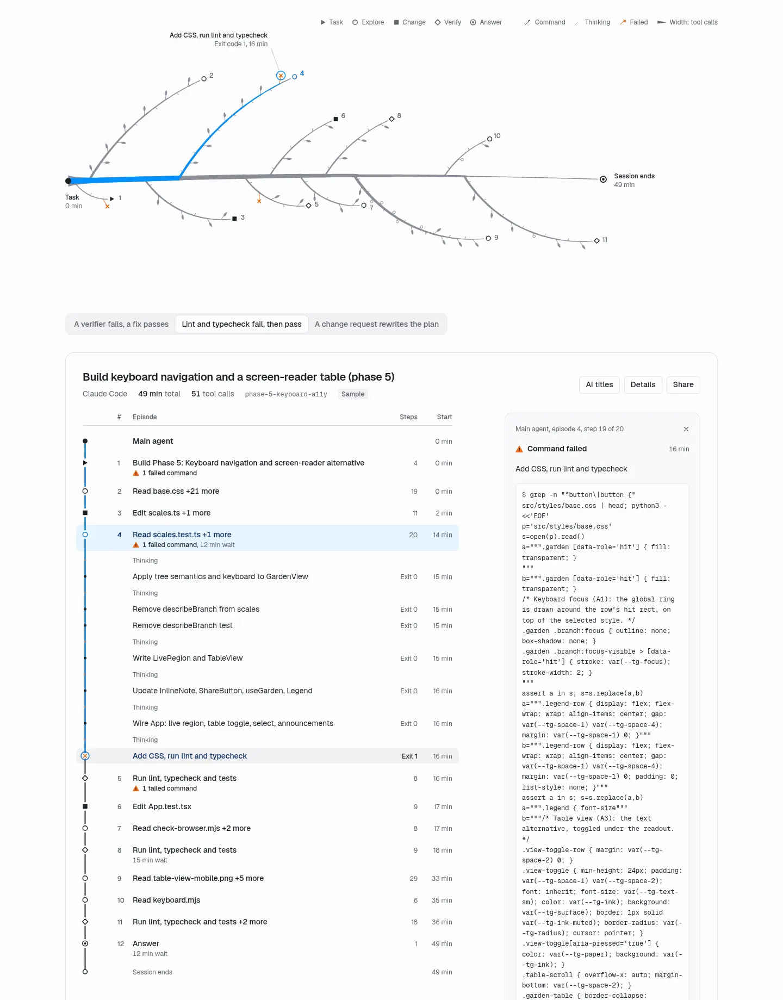
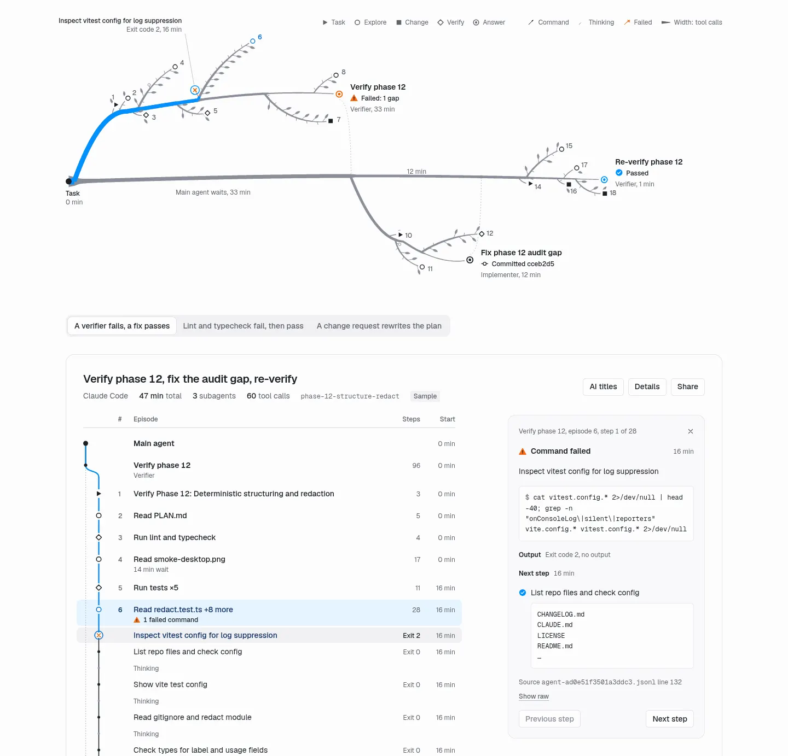
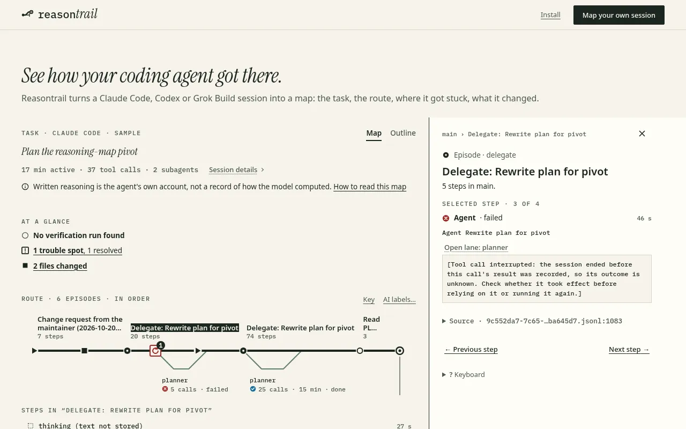

# Examples: three real sessions

These are the sample maps on the Reasontrail website. Each is a real Claude Code session of the agents that built Reasontrail, trimmed and redacted (see [`tools/session-samples.json`](../tools/session-samples.json)). They are bundled with the site, so they open offline and with no API key.

Each link opens the map with the detail panel on the step worth reading first. The links open the live demo at `reasontrail.geekplux.com`. To open the same view locally:

```sh
pnpm install && pnpm dev
# then open http://localhost:5173/ followed by the part of the link after the domain,
# e.g. http://localhost:5173/?session=implementer-checks&step=s52
```

## 1. Lint and typecheck fail, then pass

**Build keyboard navigation and a screen-reader table (phase 5).** An implementer: 142 steps and 51 tool calls, 11 minutes active over about 49 minutes.



Open it: [implementer-checks map at the first failed run](https://reasontrail.geekplux.com/?session=implementer-checks&step=s52) (`?session=implementer-checks&step=s52`)

What to notice:

- **Trouble marker 1, an error streak.** Two runs that end in checks fail in a row: first lint (oxlint reports `eslint(no-shadow)`), then typecheck (`TS2339` in `src/garden/keyboard.ts`). The link opens the first one; press → for the second.
- **The rhythm of the route.** Reading, editing and checking alternate: the three verify episodes (◇) are the points where the agent ran its checks before moving on.
- **The destination.** Six changed files, one of them new (`scripts/browser/flows/keyboard.mjs`); the last check, `pnpm lint`, passed. In its final answer the agent reports three commits and a diff over its line budget.

## 2. A verifier fails, a fix passes

**Verify phase 12, fix the audit gap, re-verify.** The main agent and three subagents: 166 steps and 60 tool calls over about 47 minutes.



Open it: [verify-fail-fix map at the first verifier’s verdict](https://reasontrail.geekplux.com/?session=verify-fail-fix&step=s96) (`?session=verify-fail-fix&step=s96`)

What to notice:

- **Three side trails.** The main route is three "Delegate" episodes (verify, fix, re-verify), and each subagent's own route hangs below the episode that started it.
- **A failure that is not a failed command.** The first verifier's answer is "VERDICT: FAIL": `pnpm audit:samples` could miss a secret inside nested JSON. No run failed, so At a glance says "No trouble detected"; the side trail is labelled FAIL, and the link opens the verdict in the agent's own words.
- **A small, checked fix.** The fix trail changes one file, `scripts/audit-samples.mjs`, and the re-verify answers "VERDICT: PASS". The destination lists that one file and a passing last check.

## 3. A change request rewrites the plan

**Plan the reasoning-map pivot.** The main agent and two planner runs: 113 steps and 37 tool calls over about 17 minutes.



Open it: [planner-pivot map at the first planner call](https://reasontrail.geekplux.com/?session=planner-pivot&step=s13) (`?session=planner-pivot&step=s13`)

What to notice:

- **A retry marker.** The first planner run is cut off before it reports back. The main agent notices that `docs/PLAN.md` is unchanged and runs the planner again with the addendum folded in: "Retried Agent once, then passed".
- **Two requests, one route.** The change request and its addendum are both on the main route, so you can see where the agent changed course: the second ▶ on the route is where the addendum arrives.
- **Reading before writing.** The second planner's trail reads the plan, the README and more before it edits `docs/PLAN.md`. The destination lists `docs/PLAN.md` and the new `.claude/agents/lead-designer.md`; nothing was tested, and At a glance says "No verification run found" rather than guessing.

## Map your own session

In a project folder where you have used Claude Code, Codex or Grok Build:

```sh
npx reasontrail
```

It maps the newest session for that folder into one HTML file and opens it. **Not on npm yet:** until it is published, run `node cli/dist/cli.mjs` from a clone instead, as in [From a clone](../README.md#from-a-clone). Add `--share` for a copy with secrets, emails and paths replaced by pattern; read it before you send it.

Have a session that would make a good example? Propose it with the session-sample issue template; [Add a sample](../CONTRIBUTING.md#add-a-sample) says how samples are made and checked.
